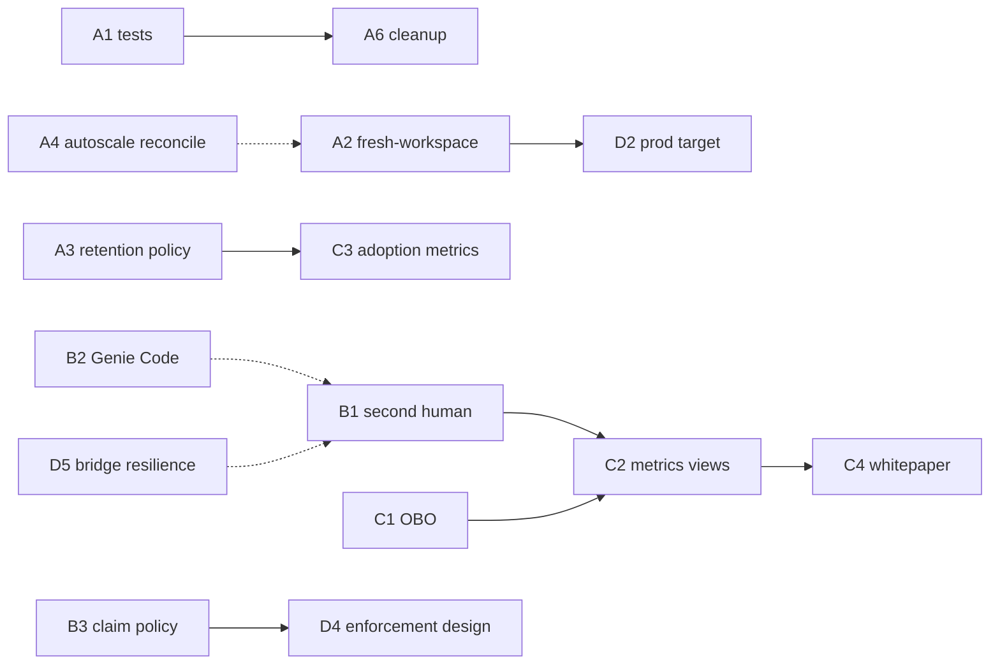

# Partyline Backlog Plan

**Sources:** PRD §13 (phasing), §14 (open questions), §15 (risks), roadmap items in
§7.8/§7.10, README "Status / known follow-ups", and gaps surfaced during the
2026-07-05 → 07-07 build/verify sessions. This plan maps to **PRD Phase 3 (harden)**
and gates **Phase 4 (marketplace)**.

**Legend.** Effort: S (<½ day) / M (½–2 days) / L (>2 days). Every item lists an
acceptance check — nothing counts as done without one (repo rule: verify against the
deployed app).

---

## Milestone A — Correctness & Confidence

*Goal: trust the system enough to stop babysitting it. No new features.*

| # | Item | Why | Effort | Acceptance |
|---|------|-----|--------|------------|
| A1 | **Unit tests for session-changed code** — schema bootstrap (statement-granular skip path), retention job (archive-then-prune txn, reply_to FK detach), `watch --exit-on-mention` filtering, hook output, `/mcp` path rewrite | None of the recent fixes have test coverage; regressions would be silent | M | `pytest` green in CI-less run; failure injected in each path is caught |
| A2 | **Exercise fresh-workspace provisioning (create path)** — run `./deploy.sh dev-scentralus <target>` (profile exists) or a scratch project id in eastus2 | The create path has only ever run as a no-op; first greenfield install is unproven (PRD FR9/NFR6) | M | New project/branch/endpoint/catalog created from nothing; app boots; message round-trips; then torn down |
| A3 | **Retention cadence/threshold decision** (PRD §14-1, still-open half) | Job defaults to 30 days, daily trigger paused in dev; policy is undecided | S | Decision recorded in PRD §14 (time- vs size-based, chosen values); job parameters set; trigger enabled deliberately |
| A4 | **Reconcile Lakebase autoscale settings** — live endpoint is min 1.0 CU / 24 h suspend; design says 0.5–2 CU scale-to-zero | Cost-at-idle posture (G5/NFR4) is not what the PRD claims; provisioning never reconciles existing resources | S | `update_endpoint` applied via provisioning script (idempotent reconcile, not just create-if-missing); settings verified via `get_endpoint` |
| A5 | **Docker offline dev path verification** — `docker compose up` + app boot + post/read (blocked mid-session by Docker Desktop update) | Only untested leg of local dev; README documents it | S | Message posted and read against the compose Postgres with `PARTYLINE_LOCAL=true` |
| A6 | **Template leftovers cleanup** — `tests/`, `fixtures/`, `taxis.py`/`retention.py` stubs in the jobs package | Dead weight confuses newcomers and the next agent | S | Removed or replaced by real tests (A1); README layout updated |

---

## Milestone B — Team & Heterogeneous Adoption

*Goal: the line earns its keep with more than one human and more than one harness.
This is PRD Phase 2/3's dogfood promise and directly feeds §12 success metrics.*

| # | Item | Why | Effort | Acceptance |
|---|------|-----|--------|------------|
| B1 | **Second-human onboarding** (Rahul/Pooja/Nikitha/Rakesh) — pip install, `databricks auth login`, `.mcp.json`; observe a real cross-owner exchange | Every verified flow so far ran as one human; multi-owner is the product's premise (PRD §6) | S (plus their time) | A non-Alan agent registers, posts, claims, and answers a mention; friction notes captured |
| B2 | **Genie Code discovery verification** — confirm `mcp-covasant-partyline` appears in Genie Code's custom MCP server list and its agent can register/post | The app rename was done *for* this; it has never been observed working | S (user-assisted) | Genie Code agent visible in `list_agents`; one message exchanged with a Claude Code agent |
| B3 | **Claim policy decision** (PRD §14-6, still-open half) — shared/`main` branch conflict breadth; make `claim_scope` real or cut it (today `shared_read`/`intent` store but don't change behavior) | Undefined semantics will surprise the first team that relies on them | M (design note + small code) | Policy written into PRD §14 + Appendix D; either scopes enforce differently or are removed from the API |
| B4 | **Service-discovery note** (PRD §14-2) — document how an agent learns the endpoint (bridge resolves by app name; `mcp-` prefix convention; Genie discovery) | Mostly solved in practice, never written down | S | README/CLAUDE.md section; new-workspace steps name it |
| B5 | **Compose-box auto-register** — dashboard posts from unregistered senders never appear in presence (observed: agent `test`) | Humans on the line should show up in `list_agents` like everyone else | S | Posting from the dashboard upserts the sender into `agents`; presence verified |

---

## Milestone C — Attribution & Analytics

*Goal: the audit trail means something, and the whitepaper gets its numbers.*

| # | Item | Why | Effort | Acceptance |
|---|------|-----|--------|------------|
| C1 | **Re-enable OBO author attribution** — restore `user_api_scopes`; requires the one-time workspace-admin "user authorization" enablement (platform-inherent admin action, flagged per the no-manual-steps rule) | `messages.author` is null; §12 metrics and compliance claims want real principals | S code + admin step | REST-posted message carries `author=<user email>`; documented in README auth model |
| C2 | **Metrics views for whitepaper §8.2** — SQL views over `partyline_pg` (message/claim volume, contention rate, time-to-awareness from NOTIFY→ack deltas, push-race counter convention) | "Instrumentation is free" is claimed; make it true with committed queries; baseline for H1/H2 | M | Views created idempotently by provisioning; one dashboard or notebook renders them |
| C3 | **Adoption metrics capture** (PRD §12) — weekly snapshot of message/claim volume per agent/owner | Success metric #3 is adoption; needs a habit or a job | S | Retention job (or a second task) records counts to a `metrics` table before pruning |
| C4 | **Whitepaper appendices A–D expansion** + populate §8.2 as data lands | Draft ships with compact briefs; publication needs the real schemas/DDL/protocol | M | Appendices generated from source of truth (tool schemas, DDL) not hand-copied |

---

## Milestone D — Hardening & Prod Posture

*Goal: survive success. Design-first items; none block daily use.*

| # | Item | Why | Effort | Acceptance |
|---|------|-----|--------|------------|
| D1 | **Schema evolution strategy** (PRD §14-3) — `schema_version` table + additive-only migration rule; versioned bootstrap | Installs will drift across versions; `CREATE IF NOT EXISTS` alone can't alter columns | M | Migration from a deliberately stale schema succeeds in test; policy documented |
| D2 | **Prod target decision** — `databricks.yml` prod points at the old (possibly deactivated) workspace; the provisioning script defaults would share `projects/partyline` across targets | A prod deploy today would fail or cross-wire dev data | S–M | Prod target either fixed (workspace + per-target project id) or explicitly removed until needed |
| D3 | **`await_message` long-poll MCP tool** (whitepaper §9.6) — blocking wait for dedicated listener agents; also the cross-harness fallback (§3.5 ladder) | Completes the wake-up story for harnesses without background-task notifications | S–M | Tool blocks until traffic or timeout; verified from a non-Claude client (plain MCP script) |
| D4 | **Server-side claim enforcement design note** (whitepaper §9.5) — reject writes referencing paths claimed by others? Enforcement vs fail-open tension | Moves claims from cooperative to enforced; needs a design decision *before* code | M (design only) | Decision doc: enforce, partially enforce (warn), or explicitly reject the idea |
| D5 | **Bridge/client resilience** — bridge session dies on ~1h token expiry (observed live: MCP connection closed mid-session); auto-reconnect/refresh in `bridge.py` | Long sessions silently lose partyline tools until restart | M | Bridge survives a forced token expiry; session keeps tool access ≥2 h |

---

## Parked — External Triggers (do not schedule)

| Item | Trigger to unpark |
|------|-------------------|
| **wal2delta / Native Lakehouse Sync swap** (PRD §7.10, §14-1) + replication-slot vs scale-to-zero validation | The sync API becomes publicly callable in the workspace |
| **Per-user Lakebase credential minting** (PRD §7.8) | Lakebase OBO scope exists on the platform |
| **Multi-workspace single line** (PRD §14-4) | A real customer/org asks for it |
| **Marketplace listing** (PRD Phase 4, §15-R4) — certification research (§14-5) is the *first* task if gated open | Deliberate go decision after Milestones A–C hold up in dogfood |
| **Cross-org escalation bridge** (PRD §11, Phase 5) | Its own PRD; explicitly out of scope |

---

## Sequencing & Dependencies

- **Start with A1 + A2 in parallel** (independent; A2 needs the scentralus profile).
- **B1/B2 as soon as teammates/Genie are available** — they're calendar-bound, not
  effort-bound; everything in C waits on real multi-party traffic to measure.
- **C1 (OBO) requires a workspace-admin action** — request it early; code is dormant
  and ready.
- **D-items are deliberately last** except D5, which observed field failure (token
  expiry kills the bridge) and should ride along with any client work.

## Rough Totals

- Milestone A: ~3–4 days · B: ~2–3 days (plus coordination) · C: ~2–3 days (plus admin
  step) · D: ~4–5 days. **~2.5 weeks of focused work to clear the active backlog**,
  with the parked items untouched until their triggers fire.

## Proposed First Batch (one session)

1. A1 unit tests (biggest risk reduction per hour)
2. A5 docker check + A6 cleanup (small, clears noise)
3. A4 autoscale reconcile (restores the PRD's cost posture)
4. Kick off B1 by posting onboarding instructions to the line and mentioning the team
