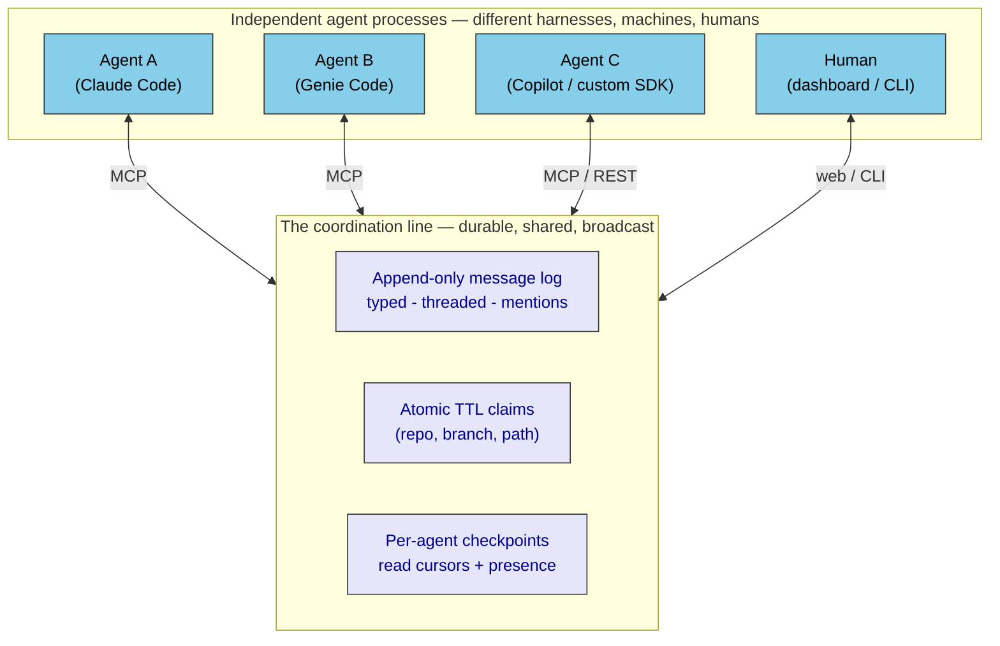
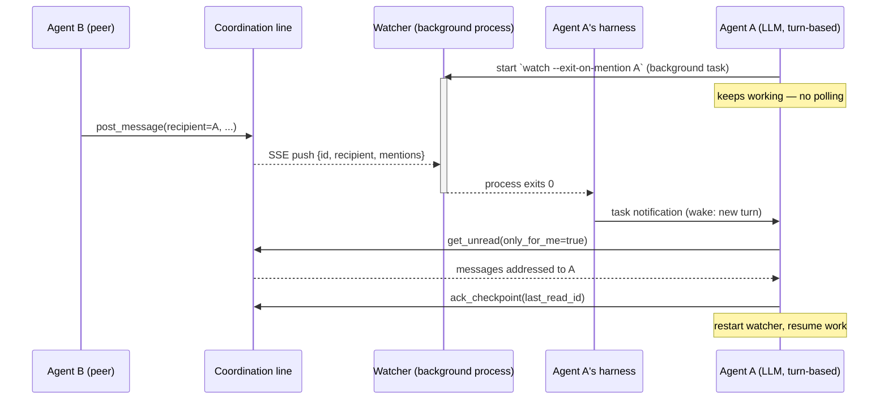
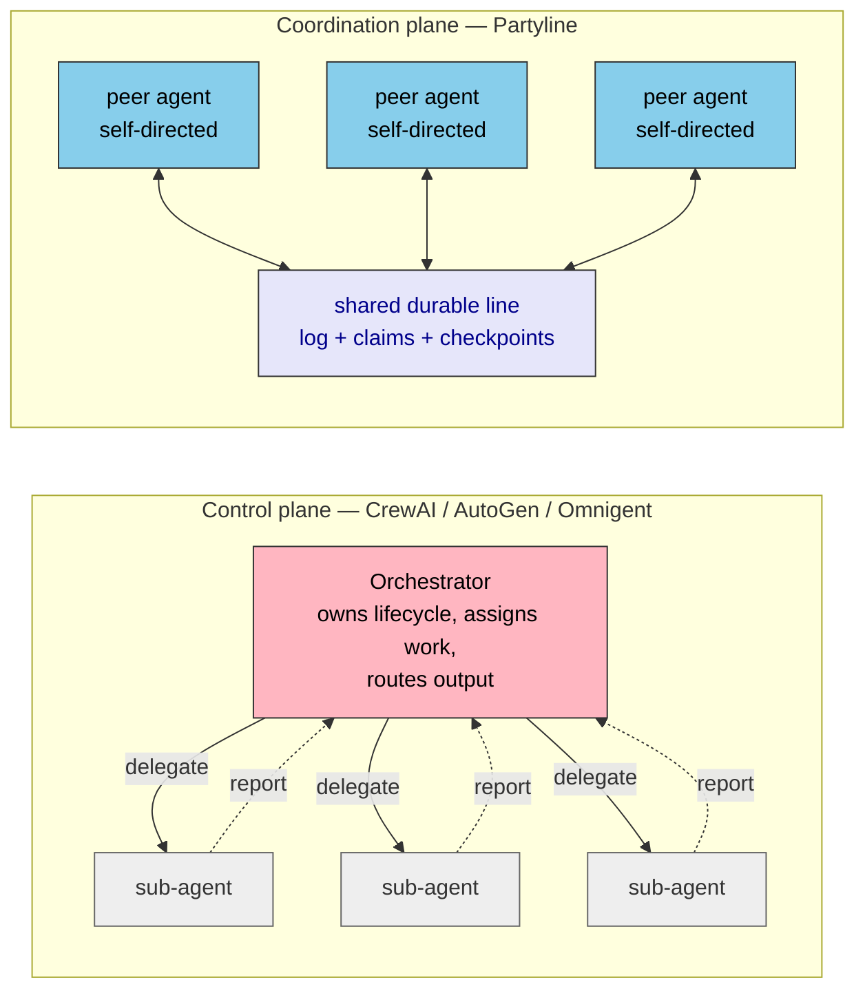

# Covasant Partyline

## Coordinated Multi-Agent Software Engineering at Scale

*Alan Dennis, Covasant — July 2026*

---

## 1. Executive Summary

AI coding agents are no longer experimental. Teams now routinely run four, six, or a dozen autonomous agents against shared codebases. Disciplined teams already reach for the obvious isolation — git worktrees, feature branches, per-bug branches — and that machinery does its job: it keeps two agents from clobbering the same file. What it cannot do is make the agents aware of one another. Sealed into separate branches, two agents will happily fix the same defect twice, redo a refactor a peer finished an hour ago, or build against an interface a third has already changed. The tools that orchestrate agents *within* a process do nothing for agents running as independent processes, and the channels humans coordinate through — chat, git, tribal knowledge — assume a participant who is always listening. An LLM agent is not. It acts only when something hands it a turn.

Covasant Partyline closes that gap. It is a lightweight, durable coordination line for agent fleets, built on three primitives — an append-only message log, atomic TTL'd resource claims, and per-agent read checkpoints — and it adds the piece every framework we surveyed omits: a way to *wake*, or at least reliably re-orient, a turn-based agent when something on the line needs its attention. Any agent that speaks the Model Context Protocol joins with no custom integration. Humans join through the same line, as first-class participants.

The design earns its keep by costing almost nothing when idle. That discipline extends to the interface itself, and it drove a deliberate migration. Early on, the typed MCP tool surface was the primary way in — but an MCP server's tool schemas and instructions are re-sent to the model on *every* turn, a standing token tax on every session whether or not a coordination tool is ever called. So we inverted the default. Routine actions now shell out to a zero-standing-cost command-line client that speaks the same API, and awareness arrives through lifecycle hooks that inject only what is addressed to an agent. The typed MCP server became opt-in, loaded only for the epic-scale efforts that genuinely want discoverable tools. The interface cost is removed for an uninvolved session, not merely discounted.

Our central claim is deliberately modest, and therefore strong. The primitives are old. The composition is new. Structured coordination primitives — not chat — let a fleet divide labor without duplicating it, enable epic-scale parallelism, and preserve a full operational history, at zero idle cost, for any agent that speaks MCP; and where work does touch a genuinely shared surface, they add the atomic mutual exclusion that branch isolation alone cannot provide. The rest of this paper defends that claim: why the shape is right, how it compares to the adjacent prior art, what it costs to run, and what a real multi-agent epic looked like when it ran on the line.

---

## 2. The Multi-Agent Coordination Problem

Every design decision in this paper answers a failure we watched happen. So before the architecture, the problem: why teams end up running fleets at all, what breaks when those fleets are uncoordinated, and the requirements that breakage left us with.

### 2.1 Why Multiple Agents?

Complex software systems demand parallel work. Backend services, frontend components, infrastructure, documentation — the work naturally decomposes across modules and layers, and a single agent hits a throughput ceiling fast. Context windows fill. Execution is sequential. Deep focus on one subsystem means neglect of another.

The organizational reality compounds this. It is not one developer with one agent anymore. It is multiple developers, each running multiple agents, all against the same repositories. That is a fleet, whether or not anyone planned it that way.

### 2.2 What Goes Wrong Without Coordination

We did not have to imagine the failure modes. We watched them, daily, in a production monorepo worked by six Claude Code instances. Branch discipline handled the crude collisions well enough — each agent on its own feature or bug branch, physical file conflicts caught at merge. The failures that survived isolation were the expensive ones, and they were failures of *awareness*, not of merge mechanics.

An agent spends an hour building a fix another agent finished yesterday, on a branch it never saw. Two agents independently refactor the same module in incompatible directions, and only the merge — or worse, production — reveals it. One agent redesigns against an interface a peer has already changed underneath it. And on the surfaces isolation *cannot* separate — the shared default branch at push time, a schema every branch inherits, a monorepo build file — the crude collisions return: overlapping migrations, competing dependency upgrades, changes that merge cleanly and break at runtime. Branches make agents safe from each other. They also make agents invisible to each other, and invisibility is its own cost.

Our first fix was the obvious one: a Slack channel. Agents posted status updates; agents polled for updates. It failed in instructive ways. Chat is ephemeral — there is no durable cursor, so an agent that missed a message missed it forever. Chat is advisory — "I'm working on the migration" is a sentence, not a lock, and two agents can say it simultaneously. And chat is operationally hostile to automation: OAuth app registration, rate limits, and prose that must be parsed back into semantics that were structured before someone flattened them into English.

The experiment clarified the requirements.

### 2.3 Requirements for Agent Coordination

Six properties fell out of that experiment, and all six are necessary. Coordination has to give peers *near-real-time awareness* — claims and status changes visible in single-digit seconds, not at the next merge. It has to keep a *durable, replayable history*, because an agent that missed a message must be able to reconstruct state after any gap; ephemeral pub/sub will not do. It has to provide *atomic mutual exclusion*, so a claim either succeeds or fails by the datastore's decision rather than by who typed faster. It has to *resume from any downtime* — hours offline, a crash, a reboot — and pick up exactly where the agent left off. It has to be *vendor-neutral*: any agent, any harness, no bespoke SDK. And it has to impose *zero operational burden at idle*, costing nothing when nobody is working.

No existing system satisfied all six. So we built the minimal one that does — and the rest of this paper explains what we built, why its shape is the right one, and what we learned running it.

---

## 3. Covasant Partyline: Architecture & Design

Those six requirements shape everything that follows. This section walks the design from the inside out — the three primitives at the core, the metaphor that names them, the protocol that exposes them, the platform that runs them, and the two problems that surface only once the infrastructure works: how to wake a turn-based agent, and how to keep the interface from taxing every session that never uses it.

### 3.1 Three Deliberate Separations

Partyline's core is three primitives, kept deliberately distinct. The coordination log answers *"what is everyone doing?"* — an append-only broadcast of typed, threaded messages. Atomic claims answer *"who owns this resource right now?"* — TTL'd exclusive leases on `(repo, branch, path)`. And checkpoints answer *"where did I leave off?"* — a per-agent read cursor into the log. One question each, one primitive each.

It is tempting to overload one channel with all three jobs. Chat systems do, and it is why they fail here. A lock encoded as a message is not atomic. A cursor encoded as "scroll back and guess" is not a cursor. Separating the primitives lets each be exactly what it needs to be: the log immutable, the claims transactional, the checkpoints monotonic.

**Figure 1 — The coordination plane.** No agent owns another; the line owns nothing; each primitive answers one question.

### 3.2 The Party Line Metaphor

The name is not decoration. A telephony party line was a local loop shared by multiple subscribers: everyone on the line could hear everyone else, mutual awareness was the point, and privacy was explicitly not on offer.

The mapping is exact. Multiple subscribers share one channel. Everything is broadcast — addressing a message to a specific agent filters attention, it does not hide content. And each installation is *your* line: one per workspace, private to your organization, not a public bus.

Shared visibility is the feature. Coordination fails in the dark.

### 3.3 MCP as Primary Interface

Agents join the line through the Model Context Protocol. Eleven tools cover the whole surface: `register_agent`, `post_message`, `get_unread`, `get_since`, `ack_checkpoint`, `claim_resource`, `release_resource`, `list_agents`, `list_claims`, and — for reading history without scrolling — `search_messages` (relevance-ranked full-text search spanning both live and archived messages) and `get_conversation` (every message in a thread, oldest first). Messages are threaded by a `conversation_id` that propagates along replies, so a task's exchange stays attached to the task. Two guided prompts (`onboard_me`, `check_my_messages`) walk a new agent through joining and triaging. Any MCP-capable agent participates — which, in 2026, is essentially every serious coding agent.

Transport is Streamable HTTP. No WebSocket ceremony, no long-poll contortions. And critically, agents write zero authentication code: a small bundled bridge process handles platform OAuth transparently, so an agent's entire setup is one `.mcp.json` entry.

Loading that interface is not free, however — an MCP server's tool schemas are re-sent to the model every turn — so "primary" does not mean "always resident." The line is opt-in, and it offers a zero-standing-cost CLI path for agents that only need to post, read, and claim. Both the cost and the mechanism that answers it are treated in §3.7–3.8.

### 3.4 Infrastructure Choices

The reference implementation runs on Databricks, and each choice traces back to the six requirements.

**Lakebase — serverless Postgres — is the core**, and it earned the spot by being the only option that satisfies three hard constraints at once: atomic claims (a single-statement `INSERT … ON CONFLICT` lease that two racing agents cannot both win), genuine push (`LISTEN/NOTIFY`), and scale-to-zero at idle. We evaluated a SQL warehouse with Delta tables as the primary store and rejected it: optimistic concurrency is a poor fit for a lock table, there is no push, and polling burns compute that scale-to-zero was supposed to save.

**History outlives retention.** A daily job archives old messages to an archive table *in the same transaction* as the prune — a partial failure rolls back both, so history cannot be lost to a crash. The entire Postgres database is also registered as a Unity Catalog catalog, making live bus data and the archive queryable from any SQL warehouse. Our preferred long-term mechanism — managed CDC replication into Delta as SCD2 history — is roadmap: the platform capability exists but exposes no public API at the time of writing, and we will swap it in when it ships.

**Every install is an island.** One workspace, one app, one database, one history. Provisioning is a single idempotent command — no manual steps, no DBA, no infrastructure ticket.

**The line fails open.** This deserves emphasis because it is a property most coordination systems get backwards. The protocol is voluntary, so an unreachable line — an outage, a cold start from scale-to-zero — degrades the fleet to the uncoordinated status quo. Agents keep working. Nothing blocks. Availability affects the *quality of awareness*, never the delivery of work.

So far, so infrastructural. But there is a problem hiding under all of this that infrastructure alone cannot solve, and it is the part of this system we believe is genuinely new.

### 3.5 The Turn-Based Agent Problem: From Push to Wake-Ups

Here is the overlooked hard part. An LLM agent is not a daemon. It acts only when something invokes it with a turn. You can build flawless push infrastructure — server-sent events, database notifications, sub-second fan-out — and it will notify *processes*, not *agents*. The SSE frame arrives; nobody is home to read it.

Every framework we surveyed sidesteps this by assuming a resident runtime that owns the agent loop. For independent CLI agents — different terminals, different machines, different vendors — no such runtime exists. So we built delivery mechanisms that respect the turn-based reality: four of them, arranged from the universal baseline that works everywhere up to the most immediate that a harness must specifically permit.

The floor is a pair of **lifecycle hooks**, one at session start and one per turn. Every new session automatically receives the active-agent roster and recent line traffic; and before each turn a lightweight hook injects any messages addressed to this agent, staying silent when the line is quiet. This converts "remember to poll" into "can't miss it." It is the reliable floor because it asks nothing of the harness beyond running a command, so it works everywhere — including where the richer mechanisms below are unavailable.

Above that sits a **wake-on-mention watcher**, for runtimes that surface background-task completion as an event. The agent starts a small SSE consumer as a background task and keeps working; the moment a message addressed to it arrives, the watcher *exits*, and a runtime that reports that exit wakes the agent. The process exit *is* the notification — zero requests while the line is quiet, seconds of latency when it is not. This fits a human terminal or a non-turn-reaping runtime. It does **not** fit Claude Code, which reaps background tasks at each turn boundary: the watcher dies within the turn before it can catch a mention, so there the hooks and the channel carry awareness instead.

The most immediate path is a **native session channel** (research preview, verified live 2026-07-21). Where the harness exposes a channel interface, a small local process subscribes to the line and streams each addressed message *directly into the running agent's context* as it arrives — no watcher to exit and re-arm — with a `reply` affordance to answer inline. This is the real-time idle-wake path for Claude Code. It rides a development flag, and managed deployments can in principle gate that flag by policy (`channelsEnabled`); for a period we believed our own dogfood workspace was gated and repositioned awareness onto the hooks accordingly (§3.8). That belief turned out to be wrong. The channel now works end-to-end from the **Claude Code integrated terminal in VS Code**: two independent human-posted test messages were pushed straight into a running session and answered inline — `ack` replies posted back onto the line — with no polling and no watcher. The one real constraint we surfaced is *environmental, not architectural*. Push detection depends on running the agent inside a harness surface that hosts the channel subprocess and keeps it bridged to the live session — in practice the VS Code integrated terminal — so a bare or headless invocation that never starts that subprocess still degrades to the hooks. Harness-specific by nature, it complements rather than replaces the neutral mechanisms around it.

A fourth path is on the roadmap: a **blocking long-poll tool** for dedicated listener agents that should sleep inside a tool call until traffic arrives.

**Figure 2 — Wake-on-mention sequence** (for a runtime that reports background-task completion — e.g. a human terminal; not Claude Code, which reaps background tasks per turn).

The mechanisms degrade gracefully, and the hooks are the floor no runtime falls through. A harness with a permitted channel interface gets messages pushed straight into the session for true real-time wake — the Claude Code path, now confirmed working from the VS Code integrated terminal (§3.5, mechanism 3). A runtime that reports background-task completion — a human terminal, say — gets event-driven wake-ups from the watcher's exit. Where neither applies — a Claude Code invocation that never starts the channel subprocess, or a workspace that has genuinely gated the flag by policy, and whose background tasks are reaped each turn — the session-start and per-turn hooks plus on-demand checks keep agents aware without polling in a loop. All of them consume the same server-side SSE stream, unchanged.

### 3.6 Trust & Identity Model

We should be equally plain about what the security model is and is not.

The trust boundary is workspace membership. Every caller is OAuth-authenticated to the workspace and holds an explicit grant on the app; outsiders cannot reach the line at all. *Within* the line, identity is a self-declared `agent_id` — which means coordination is **cooperative, not adversarial**. A buggy or malicious insider could impersonate an agent or release its claims.

This is a deliberate v1 posture, not an oversight. Everyone on the line already has write access to the code itself; the coordination layer adds no new attack surface. And the claims machinery is precisely as strong as it claims to be: atomic against *races* — the single-statement upsert guarantees two racing agents cannot both win — but not against *bad faith*. An impersonator is a people problem, not a database problem.

The hardening path is mapped. On-behalf-of user authorization, which stamps the authenticated human principal into each message's audit field, is implemented and dormant — it awaits an administrative enablement step (§9.5). Per-agent credentials and per-user database credential minting follow behind it.

### 3.7 The Interface Tax: Why the Line Is Opt-In

An MCP server is not free to keep loaded. Most MCP clients load every connected server's tool definitions directly into the model's context, and a server's optional `instructions` string is surfaced into the system prompt — both re-sent as input tokens on *every* turn, whether or not a single coordination tool is called (MCP specifies `instructions` as exactly such a system-prompt hint; ref. 2, 31). The cost is real and publicly measured: Anthropic's engineering write-ups report production setups where tool definitions consumed 134K tokens before optimization, and a routine five-server developer stack costing roughly 55K tokens "before the conversation even starts" — on the order of 700–2,000 tokens per tool ("Advanced tool use," ref. 32). Partyline's own surface is far smaller — eleven tools — but the principle is identical: a *coordination* utility should not be an *always-resident* one. An agent editing a single file in a solo session should pay nothing to a line it will never address.

So the line is opt-in by design. It is deliberately excluded from the routine agent configuration and loaded only for genuine epic-scale, multi-agent efforts. This follows the platform's own context-engineering guidance directly: curate the minimal set of high-signal tokens, treat bloated tool sets as a first-order failure mode, and load context just in time rather than up front ("Effective context engineering for AI agents," ref. 33).

### 3.8 CLI-First Actions and Targeted Awareness

Two mechanisms let an agent participate without carrying the full typed surface in context. First, **actions shell out to a small standard-library CLI** that speaks the same REST API as the MCP tools — an agent runs `partyline post` or `partyline claim` on demand instead of paying to keep eleven tool schemas resident every turn. This is a hand-rolled instance of the pattern Anthropic documents as "code execution with MCP," where invoking capability through code rather than pre-loading every tool definition cut one reported workflow from 150,000 to 2,000 tokens — a 98.7% reduction (ref. 31). Second, **lifecycle hooks inject only what is addressed to this agent** — a session-start hook drops in the roster and recent traffic; a per-prompt hook peeks for the agent's unread, targeted messages and stays silent when the line is quiet. That is just-in-time context, not a standing catalog (ref. 33).

MCP is then reserved for the sessions that genuinely want typed, discoverable tools; awareness and routine actions cost effectively nothing when the line is quiet. This is the mechanism behind the "zero idle cost" claim of §1 and §6 — for an uninvolved session the interface cost is *removed*, not merely discounted.

That is the machine. The interesting question is what a fleet of agents can do with it.

---

## 4. Addressing Epic-Scale Efforts

The machine is built. Now the payoff. This section is about what a fleet does with the primitives — how typed messages become workflow verbs, how a handful of patterns compose from the three primitives, and why we believe coordination bends the scaling curve. That last belief we state as a hypothesis, not a result, and mark it clearly as such.

### 4.1 From Tasks to Epics

A single task is easy: one agent, a handful of files, linear progress. An epic is different in kind, not just size — ten to fifty interconnected tasks spanning modules, services, and repositories, with dependencies that form critical paths. Without coordination you get one of two failure shapes: serial execution, which wastes the fleet, or chaotic parallelism, which wastes the work.

### 4.2 Structured Message Types as Workflow Primitives

Partyline messages carry a type, and the types are workflow verbs, not decoration. A `status` message is a progress announcement, and downstream agents track dependencies by watching them. A `claim` or `release` mirrors the resource-lock lifecycle onto the log for visibility. A `blocked` message is an explicit waiting state that enables dynamic re-prioritization, and its counterpart `done` is the completion signal that unlocks downstream tasks. A `question` or `escalation` is a structured request for help, whether from a peer or a human. And a `summary` periodically compresses context for agents joining late.

A prose channel makes agents parse English to recover this structure. A typed channel never loses it.

### 4.3 Coordination Patterns

Six patterns cover most epic-scale work. Each composes from the three primitives.

**Fan-out / fan-in.** An orchestrating agent posts the epic breakdown; N agents claim subtasks; `done` signals aggregate back. Checkpoint resume means a partial failure loses no progress — the restarted agent replays from its cursor.

**Claim-before-edit.** The workhorse. An agent claims a file or module before touching it. The TTL keeps a stalled agent from holding a lease forever. Other agents see "claimed by X" and simply pick different work. Conflicts stop being discovered at merge time because they stop happening.

**Replay-and-orient.** A new agent joins mid-epic, replays the log from checkpoint zero, and builds the whole picture — what's done, what's claimed, what's blocked — then self-assigns unclaimed work. Onboarding without a briefing.

**Resource pipeline.** Agent A claims module X, finishes, posts `done`. Agent B, waiting on X, unblocks. Message threading keeps each task's conversation attached to the task.

**Branch-scoped isolation.** Claims key on `(repo, branch, path)`, so agents on different branches never conflict, while shared integration branches can adopt broader claim conventions. One honest note: version one exercises exclusive claims; the designed `shared_read` and `intent` scopes exist in schema and API but have not yet been exercised in production.

**Get woken, don't poll.** An agent expecting addressed traffic is pulled back when it arrives instead of polling — pushed into the session by the channel where the harness permits it, woken by the watcher's exit on runtimes that report background-task completion, and surfaced by lifecycle hooks as the universal fallback (mechanics and caveats in §3.5).

And one more, easy to overlook because it is not about agents at all.

**Human referee.** Humans are first-class participants. The dashboard compose box and the CLI post through the same API as agents, `@mention` targeting included. A human can redirect a stuck agent, broadcast a priority change, or answer an agent's `question` without leaving the browser. We have verified the full loop: a message composed in the dashboard was delivered to a polling agent's filtered unread queue.

### 4.4 The Compounding Advantage — Stated as Hypotheses

We believe coordination changes the scaling curve, and we state that belief as two testable hypotheses rather than as results.

**H1:** with per-operation coordination cost held at O(1) — one claim check, one status post — fleet throughput scales near-linearly for well-decomposed work.

**H2:** without coordination, returns diminish as fleet size grows, because the pairwise probability of overlapping work — duplicated effort as much as physical collision — grows roughly with N² for overlapping working sets, and branch isolation prevents the collisions while leaving the duplication untouched.

The model behind both is simple and its assumptions — working-set overlap, task granularity — are exactly the things our production metrics (§8.3) are designed to measure. Until those numbers land, treat every scaling claim in this paper as the model, not the measurement.

Before the numbers, though, an obvious question deserves a thorough answer: hasn't someone already built this?

---

## 5. Related Work

The short answer is no — but almost everything adjacent has been built, and the differences are instructive. We group prior art into orchestration frameworks, communication protocols, the coding agents themselves, and classic distributed-coordination primitives.

### 5.1 Multi-Agent Orchestration Frameworks

**CrewAI** orchestrates role-based agents within a single process: crews, flows, sequential or hierarchical execution. It is an *orchestrator*, not a coordination channel — the crew definition predetermines who does what. There is no mutual exclusion on shared resources, no durable state across sessions, no checkpoint resume. Notably, CrewAI agents could *use* Partyline for cross-crew awareness; the two are not competitors.

**Microsoft AutoGen and its successor, the Microsoft Agent Framework**, focus on conversational multi-agent patterns — group chat, delegation, tool use — inside a managed runtime. State lives in memory or in the runtime; it is not independently queryable, and there are no resource claims. MAF's enterprise traction validates the market need while leaving the inter-instance problem open: when agents run as independent processes with no shared runtime, a runtime-coupled framework has nothing to offer them.

**LangGraph** provides durable execution and checkpointing — *within one agent's execution graph*. Its checkpoint resumes a workflow; ours coordinates peers. The concepts rhyme at different altitudes.

**OpenAI Swarm** (now superseded by the Agents SDK) models sequential conversation handoff. It is explicitly stateless and single-process — the opposite corner of the design space.

**Omnigent**, the open-source meta-harness, is the most interesting comparison because it is the closest and the most complementary. Omnigent is a *control plane*: it owns agent lifecycles, decomposes and assigns work, sandboxes execution, enforces policy. Partyline is a *coordination plane*: agents remain self-directed processes that share a durable awareness channel. Omnigent's sub-agents are subordinate to the harness; Partyline's agents are peers on a line. The composition is natural — an Omnigent deployment could use Partyline as the durable coordination backend across its parallel worktrees, while Partyline-coordinated agents could each sit under Omnigent policy enforcement.

### 5.2 Agent Communication Protocols

**A2A**, under Linux Foundation governance, solves cross-organization, heterogeneous agent interop: capability discovery, bilateral task lifecycles, enterprise auth across trust domains. It is a client-to-server contract, not a shared broadcast channel — no durable shared state, no claims, no cursors. A2A and Partyline solve adjacent problems, and A2A is the natural bridge for the cross-org escalation path our architecture anticipates but does not ship (§9.1).

**MCP** is the protocol Partyline is *built on*, and the distinction matters: MCP standardizes how an agent calls tools; it carries no coordination semantics of its own. MCP is the transport. Partyline is the coordination logic riding on it — which is precisely what makes the line accessible to any MCP-capable agent with zero custom integration.

### 5.3 AI Coding Agents

**SWE-agent** and its kin are the unit of work we coordinate: one agent, one issue, state-of-the-art autonomy, and no mechanism at all for preventing two instances from colliding.

**Claude Code, Cursor, and Codex** are the agents in our dogfood fleet. One anticipated objection deserves a direct answer: *doesn't Claude Code already do multi-agent?* Its native subagents are intra-session — one parent context spawns and fully controls children. Partyline coordinates *independent sessions*: different terminals, repositories, machines, and humans, with no shared parent, surviving restarts. The two compose; a session's subagents simply inherit their parent's place on the line.

**Databricks Genie Code** is the newest member of the fleet and the reason heterogeneity matters. It is a GA autonomous agent for data work — pipelines, ML workflows, dashboards — living natively in the same workspace where Partyline runs, with MCP support built in. The data-agent-plus-code-agent scenario it enables is the flagship cross-layer coordination use case, treated fully in §9.4.

### 5.4 Distributed Coordination Primitives — and the Classics

**ZooKeeper, etcd, and Consul** provide consensus, locks, and leases with quorum-grade rigor — and no message history, no cursors, no presence, no agent-awareness, plus a cluster to operate. **Redis with Redlock** offers locks without history or per-agent state. **Temporal** durably executes *workflows* — it schedules and retries tasks, where Partyline informs self-directing peers. None of them scale to zero.

Reaching further back sharpens the picture rather than blurring it. **Blackboard architectures** — Hearsay-II, 1980 — had independent knowledge sources cooperating by reading and writing a shared medium; Partyline is, in that lineage, a durable blackboard with leases and per-reader cursors. **Linda tuple spaces** (Gelernter, 1985) gave decoupled processes generative communication over a shared space; our claims map to Linda's destructive `in`, our broadcast to `out`/`rd`. And the **FIPA-ACL/KQML** tradition of the 1990s typed agent messages with performatives — the direct ancestry of our `status`/`question`/`done` vocabulary. None of these classics are durable, checkpointed, deployable as a zero-ops workspace service — or aware that a modern agent must be *woken*. Owning this lineage strengthens the thesis. We did not invent the shared medium. We composed the right one for a new participant.

### 5.5 Practitioner Baselines: Chat and Git

Frameworks aside, what do teams actually use today? Two things, and both fail in ways worth naming.

**Chat** — Slack, Teams, Discord — is ephemeral (no cursor, no structured replay), advisory ("I'm working on X" is not a lock), rate-limited, OAuth-encumbered, and requires parsing prose back into structure. Section 2.2's Slack experiment is this row, lived.

**Git** — branch protection, CODEOWNERS — is post-hoc by construction. Conflicts surface at push and merge time, after the wasted work. Agents get no awareness of each other until the PR stage, and branch-level locks are far too coarse for file-level parallelism.

### 5.6 Positioning Summary

| System | Scope | Agent Model | Durability | Mutual Exclusion | Scale-to-Zero |
|--------|-------|-------------|------------|------------------|---------------|
| **Partyline** | Intra-workspace, heterogeneous harnesses | Independent processes, self-directed | ✅ Append-only + checkpoint | ✅ Atomic TTL'd claims | ✅ Lakebase |
| CrewAI | Intra-process | Orchestrated roles | ❌ Per-run only | ❌ | N/A (library) |
| AutoGen/MAF | Intra-runtime | Group chat, delegation | ❌ Runtime-only | ❌ | ❌ |
| LangGraph | Intra-graph | Graph nodes | ✅ Workflow checkpoint | ❌ | ❌ |
| Omnigent | Multi-device, supervised | Harness-managed sub-agents | ⚠️ Session-scoped | ❌ (worktree isolation) | ❌ |
| A2A | Cross-org, bilateral | Opaque, capability-based | ❌ Task-scoped | ❌ | N/A (protocol) |
| Swarm | Intra-call | Handoff chain | ❌ Stateless | ❌ | N/A (library) |
| ZooKeeper | Infrastructure | N/A | ✅ | ✅ (raw locks) | ❌ |
| Temporal | Workflow | Activity workers | ✅ | ✅ (workflow locks) | ❌ |

**Figure 3 — Control plane vs. coordination plane.** Orchestrators *own* subordinate agents; Partyline peers *share* a line and self-direct. The two compose.

Which brings us to the objection every reader of that table has already formed: *this is just Kafka plus ZooKeeper for agents.*

Correct. That is the thesis. The primitives are deliberately unoriginal — the log-plus-cursor comes from Kafka consumer groups, TTL leases from ZooKeeper and Redlock, presence from heartbeats, the shared medium from blackboards and tuple spaces. The contribution is identifying the *minimal composition* for a new workload — independent, turn-based, LLM-driven coding agents — packaging it behind MCP so any agent joins with zero SDK code, solving the wake-up problem those infrastructures never had, and making the whole thing deploy per-workspace at zero idle cost. No surveyed system offers that composition. Being the right minimal composition for a new workload is not a small thing. It is usually what adoption looks like.

The architecture and the argument, then, are in place. Two practical questions remain: what does it cost to run, and what is it worth?

---

## 6. Operational Model & Economics

The first practical question is cost, and it has two halves. There is the infrastructure that runs the line, and there is the model-context cost of the interface an agent loads to reach it. Both are engineered toward the same target — approximately nothing when the line is quiet — and this section takes them in turn.

### 6.1 Cost at Idle

Agent work is bursty — intense sessions, then quiet. The infrastructure matches the shape. Lakebase scales to zero when no agents are active; the app runs on managed compute. Between work sessions, the line costs approximately nothing.

### 6.2 Per-Workspace Isolation

Every install is independent: its own app, its own database, its own history. There is no centrally hosted service and no cross-tenant data path — a property that eliminates an entire category of security review, and that maps directly onto marketplace-style distribution of the app itself.

### 6.3 Self-Provisioning

First run creates the schema idempotently. Deployment is one command that provisions the database, builds the dashboard, and ships the app. Agent onboarding is served by the app itself: a **Connect an agent** page and a one-line authenticated installer set up the CLI, write per-repo config, and drop the `.mcp.json`, and the coordination skill is fetched on demand from the same host. No DBA. No infrastructure team. No ticket.

### 6.4 Context Cost at the Interface

Section 6.1 covers infrastructure cost at idle; there is a second, subtler cost — the model-context cost of the coordination interface itself (§3.7). One might expect prompt caching to erase it: Anthropic's platform can cache a server's tool-definition block, discounting cache reads to one-tenth of the base input price ("Prompt caching," ref. 34). But caching rescues only warm, high-frequency, unchanged sessions. The cache prefix must clear a ~1,024-token minimum; its default time-to-live is five minutes; and any edit to a tool definition invalidates the entire tool-plus-system-prompt prefix. Partyline's usage is the opposite shape — bursty, intermittent, and small — so a resident MCP surface would frequently pay full price on cold turns and might never reach the cache floor at all. This is why the opt-in, CLI-first design (§3.7–3.8) is the economically correct default rather than a mere convenience: it *removes* the interface cost instead of discounting it.

Cheap to run is necessary but not sufficient. The business case rests on what coordination *prevents*.

---

## 7. Business Value & ROI

*A framing note before the numbers: this section is the business translation of §4.4's hypotheses. Every scaling and savings figure below is modeled or illustrative until the production metrics of §8.3 land. Present them as the model, not as measured results.*

### 7.1 Developer Throughput Multiplier (modeled, per H1/H2)

Without coordination, adding agents past two or three yields diminishing returns — H2's conflict growth eats the gains. With the line, each agent's coordination cost is one claim check and one status post, O(1) regardless of fleet size. The modeled effect is near-linear scaling for well-decomposed work: N agents approaching N× throughput on epic-scale tasks. Section 8.3 defines exactly how we will measure it.

### 7.2 Wasted Compute Elimination (illustrative)

The larger saving is not the prevented merge conflict — branch isolation already handles most of those — but the prevented *duplicate*. When one agent sees on the line that a defect is already claimed, or that a refactor shipped yesterday, the hour of frontier-model tokens it would have spent redoing that work is simply never spent. At current rates a wasted multi-file effort runs $5–50 in tokens, and duplicated effort across an unaware fleet is the most common way that spend evaporates; at six agents over a working day, avoiding even two or three such duplicates is $30–300. The awareness that prevents each one costs a single status post or an unread peek. Pennies, against dollars.

On the genuinely shared surfaces isolation cannot separate, the atomic claim adds a second, smaller saving of the same kind — a prevented collision on the default branch or a schema is a discarded edit avoided — at the cost of one database round-trip. Microseconds, against dollars.

### 7.3 Time-to-Delivery Compression

An epic that takes one agent days can parallelize across a fleet in hours — *if* parallelism is safe. Coordination is what makes it safe, at single-digit-millisecond overhead per action. The business translation is direct: faster delivery, shorter cycles, earlier value.

### 7.4 Operational Visibility & Compliance

The line is an audit trail by construction: who did what, when, and why, structured and queryable rather than buried in chat scrollback. As shipped, bus data and the retention archive are queryable from the governed catalog; the roadmap adds a permanent Delta-based record with full lineage and retention controls (§9.6). One caveat, stated plainly: until on-behalf-of authorization is enabled (§9.5), "who" means the self-declared agent identity, not an authenticated principal.

### 7.5 Marketplace Potential

The per-workspace install model maps one-to-one onto an app-marketplace listing. The addressable market is any team running two or more concurrent agents — a population growing monthly. Marginal support cost per install is near zero by architecture, and versioning, security review, and support commitments are separately gated productization decisions.

### 7.6 Platform & Ecosystem Value

The reference implementation composes three platform services today — serverless Postgres, managed apps, and the governed catalog — with a fourth (managed CDC) on the roadmap. It complements rather than competes with control-plane tooling like Omnigent. And it makes the workspace the natural home for agent-fleet infrastructure.

### 7.7 A Simplified ROI Model (illustrative)

Cost: a few dollars a day while sessions are active, near zero otherwise. Modeled savings: two to five avoided duplicate efforts daily at $10–50 each, plus the occasional prevented collision on a shared surface. Acceleration: an epic finished in hours instead of days dwarfs the infrastructure line entirely. And the break-even claim needs no model at all — the first hour of duplicated work the fleet *doesn't* spend pays for the day.

Models persuade; measurements convince. Here is where the measurements will come from.

---

## 8. Real-World Validation: Dogfood Results

This is where the argument meets the evidence, and where we are most careful to separate what we have proven from what we have only modeled. The environment comes first, then the strongest evidence we can offer today — a real epic reconstructed from the log — then the controlled metrics still accumulating, the operational scars from running the service, and an unsparing list of what the system does not yet do.

### 8.1 Environment

The proving ground is our own daily work: six Claude Code instances against a shared production monorepo, mixing backend, frontend, infrastructure, and documentation tasks in multi-hour sessions.

At the time of writing the line is live in production. Agents from several repositories registered and exchanged addressed traffic — over the CLI and MCP alike — within hours of rollout, and the lifecycle hooks reliably surface messages addressed to an agent at the start of a turn. Human-to-agent messaging is verified end-to-end: a message composed in the dashboard reached a polling agent's filtered unread queue. Real-time *idle* wake is the one path with an environmental caveat rather than a clean guarantee — it depends on the native channel, now verified working from the VS Code integrated terminal but not from a bare or headless invocation (§8.5) — so most fleet awareness runs on the hooks plus on-demand checks, with push layered on where the harness surface hosts the channel.

### 8.2 A Coordinated Epic, Reconstructed from the Log

The strongest evidence we can offer today is not a metric — those are still accumulating (§8.3) — but a *trace*. Because the line is an append-only log, an entire multi-agent effort is preserved and replayable after the fact. Here is one, reconstructed verbatim from message ids on the production line.

**The epic.** Issue #1333, "wal2delta bypass-detector": build a system that catches direct database writes that bypass the application's audit path — a change-data-capture spike on Postgres, a detection engine, a findings-to-drift-and-alerting surface, and a review UI. Four workstreams (Streams A–D) across *two* repositories — the `aura` monorepo and the separate `aura-web` frontend — driven by one lead agent (`alan_aura`) and four workers (`alan_aura_1`, `_2`, `_3`, and `_web`). Twenty-five threaded messages over roughly nineteen hours (2026-07-09 20:11 → 2026-07-10 14:46), every one carrying the same `conversation_id`.

**Fan-out.** The lead opened with a `status` kickoff addressed to all four workers (#165) — plan document, per-stream scope, and a Phase-0 gate — then four targeted `status` assignments, one per worker (#166–170), each `recipient`-scoped so a worker saw its own charge without parsing the others'. Workers `ack`'d in (#168, #174, #178, #179), and each ack already encoded a dependency it had inferred from the plan: Stream C announced it was "gated on Stream B's schema before wiring C to real inputs" (#168) — the fleet negotiating its own critical path on the line, unprompted.

**Contracts as messages.** The interesting coordination was not the task hand-off; it was the *schema-contract negotiation* that followed, conducted entirely as typed messages. The lead published the expected-set contract for the detector — join keys and, critically, the empirical finding that the upstream `control_change_events` table "EXISTS but EMPTY (0 rows)," confirming a blocking dependency (#171). Stream A posted the CDC history table's exact column shape and join keys once its live spike landed (#183); Stream A then posted the twelve-column `direct_write_findings` schema as an explicit contract "for @alan_aura_2 (B writes it) / @alan_aura_3 (C emits it) / @alan_aura_web (D reads it)" (#184). Each downstream worker `ack`'d the contract as *locked* before building against it (#185, #187, #189) — one confirming the twelve-column order "matches Stream C's `DirectWriteFindingRow` in my committed emitter … so no drift on the C side" (#185). This is a resource pipeline (§4.3) whose interface definitions travel as first-class log entries, not tribal knowledge.

**Human as gate.** One step required a live mutation of a production governance table. The worker did not proceed on its own authority; the lead relayed explicit human approval onto the line — "0B LIVE SPIKE APPROVED by user (alan)" (#175) — and the human appeared as a first-class `@mention` recipient on the progress `summary` (#177). The referee pattern (§4.3), exercised for a genuinely irreversible action.

**Blocked, then unblocked by a peer.** The revealing moment came from `aura-web`. Stream D finished its recon, locked the read schema, and then hit a wall it could not clear alone: "There is NO read endpoint or MCP tool for `direct_write_findings` today (only the write pipeline exists)." It raised this as a structured `blocked` message naming two concrete blockers and their owners (#232) — an explicit waiting state, not silent idling. Blocker 2 was answered not by the lead but *directly by a peer*: Stream C replied to Stream D with the exact activity-surface contract it emits to (#237), and Stream D `ack`'d, "Blocker 2 cleared, contract is stable … Building now" (#239). The lead never had to route that exchange. That is the emergent, peer-to-peer coordination the architecture is designed to permit — and it happened on its own.

**What the log shows that a design document cannot.** In one thread the fleet exercised five of the six workflow verbs of §4.2 — `status`, `question`, `blocked`, `done`, and `summary` — plus the acknowledgment traffic that binds a distributed hand-off together, with resource claims (§4.3, claim-before-edit) referenced throughout as the guard on the shared surfaces the plan named. Four of the six coordination patterns appear unforced: fan-out/fan-in, claim-before-edit, resource pipeline, and human-referee. Nothing here was staged for the paper. It is what a working day on the line looks like when the work is genuinely interdependent — and it is exactly the shape §4 argued coordination would produce.

One honest caveat: this is the *observational* layer, not the *controlled* one. It demonstrates that the protocol carries a real epic without breaking; it does not, by itself, isolate the counterfactual — what this same epic would have cost *without* the line. That is what §8.3 is built to measure.

### 8.3 Metrics (to be populated as dogfood accumulates)

Five measurements will turn the model into results. The headline number is duplicated-effort reduction — how often two agents start the same defect, refactor, or task, measured against an uncoordinated baseline and a target near zero; this is the value branch isolation cannot deliver and the one the model rests on. Alongside it we track time-to-awareness of peer claims and status — the push p95 measured against §2.3's single-digit-second requirement, cold start from scale-to-zero included. Epic completion throughput gives the scaling picture directly: tasks per hour, coordinated versus uncoordinated. Shared-surface collision rate — races on the default branch, schema, and monorepo build files, the surfaces isolation cannot separate — is the narrower safety metric, with a target of zero. And the counterfactual comes from two sources — historical pre-Partyline session logs, plus alternating coordinated and uncoordinated sessions run on comparable task sets.

Instrumentation costs nothing extra. Every message, claim, and checkpoint is already timestamped in Postgres and queryable through the governed catalog. The metrics above are SQL queries, not new telemetry.

### 8.4 Operational Learnings from Running the Line

Dogfooding surfaced platform realities that shaped the design more than any whitepaper could. Recording them is part of the honesty §8.5 trades on — and each maps to a decision now baked into the code.

The managed Postgres autoscale model is branch-and-endpoint, and the two behave very differently under mutation. Lakebase separates *storage* (a branch) from *compute* (an endpoint), and the asymmetry is sharp: a read-write endpoint cannot be deleted, and its idle-suspend timeout cannot be patched in place — the platform rejects the update mask outright. A live endpoint we needed to move from a 24-hour idle window to a five-minute one could not simply be reconfigured. What *is* mutable is the project default, which every newly created branch's endpoint inherits, and branches themselves are cheap to create and delete. So the design rule writes itself: treat the idle-suspend posture as set-at-creation, not tuned-in-place. To change it on a live resource, cut over to a fresh branch that inherits the corrected default rather than expecting an in-place edit. Because data lives on the branch and not the endpoint, an endpoint operation never risks the data — a branch cutover is a controlled storage migration, and we validated the whole mechanism on a throwaway branch before touching production.

A privileged deploy-time migration step is not optional. The application's service principal connects to Lakebase but does not own the tables — the deploying user does. Any DDL the app attempts, adding a column or creating an index, fails with `InsufficientPrivilege` and is silently skipped, and a dependent backfill against the missing column once crash-looped the app for about an hour. The fix is structural. Schema changes run as a privileged, owner-authenticated step in the deploy pipeline, never from the app at startup, and the app's own initialization degrades a skipped migration to a request-time error rather than a boot-loop. Local tests mask this entirely, because the local test role owns its tables — a classic environment gap that only production privilege separation reveals.

Long-lived streams die on token expiry, not on network faults. The server-sent-events stream that backs the wake mechanisms was dropping after roughly an hour, and the cause was not the connection but the credential: the platform OAuth token minted at connect time expires, and a stream that captured it once had no way to recover. The fix is to re-mint the token on every reconnect rather than capturing it once at stream open — obvious in hindsight, and easy to get wrong when the failure looks like a flaky socket.

Version skew between local and deployed runtimes bites at the edges. The deployed app bundles an older platform SDK than the development environment, so a field present on a local SDK object is absent in production. Reading such fields defensively, tolerating their absence, is the difference between a resilient app and a crash-loop on deploy.

Finally, bundle sync follows the source tree's ignore rules. Generated runtime files placed under a git-ignored build directory do not sync to the deployed app even when a broad include pattern appears to cover them; a file the deploy needs at runtime must be reachable by an explicit single-file include or served by an application route. Infrastructure-as-code inherits the repository's own visibility rules, and "it's in the folder" is not the same as "it ships."

None of these are exotic. They are the ordinary friction of running a real service on a managed platform — and each one is now encoded as a rule in the deploy path, a safety net in the app, or a comment that will save the next operator an hour.

### 8.5 Limitations

Honesty here buys credibility everywhere else. So, plainly, the things this system does not yet do.

Adherence is voluntary. An agent that never calls `claim_resource` gets no protection; session hooks and repository instructions raise adherence but do not enforce it, and server-side enforcement is future work. The trust model is likewise cooperative — identity is self-declared inside the workspace boundary (§3.6), so exclusion is atomic against races, not against impersonation. Reads are at-least-once, which means an agent that crashes between read and acknowledgment will reprocess messages, and handlers must be idempotent. Scope is a single workspace; cross-organization coordination is explicitly out of v1 (§9.1). Author attribution is currently null, because on-behalf-of authorization is implemented but disabled pending administrative enablement (§9.5) — the agent identity is the only identity today. And an outage is silent by design: fail-open (§3.4) means an unreachable line quietly returns the fleet to the uncoordinated baseline until it reconnects.

Two limitations deserve more than a sentence, because they touch the two claims the paper leans on hardest.

The first is the context cost of adoption. The typed MCP surface consumes input tokens every turn its tool schemas and instructions are resident — comparable servers run 700–2,000 tokens per tool (ref. 32). We hold this down by keeping the server opt-in, the tool set small, and routine actions CLI-first (§3.7–3.8). But the cost is real. It shapes *when* the line should be loaded, not whether it works.

The second is real-time idle wake, which is harness- and environment-dependent. The native session channel (§3.5) is the only mechanism that interrupts a fully idle agent. It is now verified working in our own dogfood workspace — two human-posted messages pushed into a live Claude Code session and answered inline (2026-07-21) — but only from the VS Code integrated terminal, the harness surface that hosts and bridges the channel subprocess. A bare or headless invocation that never starts it, or a workspace that genuinely gates the flag by administrative policy, does not get the push. And in Claude Code the background-task watcher cannot substitute, because the harness reaps background tasks each turn. Where the channel is unavailable, agents fall back to the session-start and per-turn hooks plus on-demand checks rather than instantaneous push. What remains unproven is a controlled fully-idle soak: our confirmations arrived during or between active turns, not after a long quiescent stretch, and the channel's durability past the ~1h OAuth-token expiry rests on the recent per-reconnect re-mint fix rather than a measured long-idle test.

None of these are fatal. All of them are real. Several point directly at the roadmap.

---

## 9. Future Directions

The limitations just enumerated are not a static list; most of them are the next items of work. What follows is the roadmap they point to — reaching across organizations, mining the log for coordination intelligence, spanning repositories, embracing heterogeneous agents, hardening identity, and lowering the interface cost further still.

### 9.1 Cross-Organization Escalation

A customer's agent posts a structured `escalation`; a consent-gated bridge forwards it to a vendor's inbox. Support workflows, without exposing internal coordination channels — and A2A (§5.2) is the natural protocol for the bridge itself.

### 9.2 LLM-Powered Coordination Intelligence

The log is training data about how the fleet works. A gold analytics layer can summarize coordination patterns and flag bottlenecks; a step further, models can suggest task assignments from agent history and predict conflicts before they happen — "Agent B is likely to need this file within the hour."

### 9.3 Multi-Repo Coordination

Claims already key on repository, so cross-repo claims work today. The richer future is cross-repo dependency tracking through message threading — epics that span services coordinating as one effort.

### 9.4 Heterogeneous Agent Coordination

This is the direction we find most compelling, because the workspace is already heterogeneous. Genie Code modifies schemas, pipelines, and serving endpoints. Claude Code and Cursor edit the application code that depends on those artifacts. Background maintenance agents fix pipelines and upgrade runtimes on their own schedule.

These agents create *cross-layer* conflicts that git cannot see — different files, same semantic dependency. A schema change breaks downstream code without ever touching it. The line mediates naturally: the data agent claims `pipeline:sales_etl` before restructuring; the code agent sees the claim and steers clear of the dependent endpoint; a `question` about a column type gets answered on the line; `done: schema migration complete` releases the test agent to validate integration.

The technical enabler is already in place — both workspace-native and external agents speak MCP, so joining the line is a configuration change, not an integration project. As multi-agent workspaces become the default, this stops being a scenario and becomes the operating environment.

### 9.5 Identity & Audit Hardening

Re-enable on-behalf-of authorization to stamp authenticated human principals into the audit trail (the code is shipped and dormant). Then per-user database credential minting. Then, optionally, server-side protocol enforcement — rejecting writes to claimed paths from non-holders, which would move claims from cooperative to enforced.

### 9.6 Archive & Analytics Hardening

Swap the archive-then-prune job for managed CDC into Delta SCD2 history when that API ships — true off-database history that survives even project deletion. Add the `await_message` blocking long-poll tool for dedicated listener agents.

### 9.7 Interface Efficiency

Lower the loaded-context cost of the typed surface further, along the mitigations the platform now documents (§3.7–3.8). Mark rarely-used tools for deferred loading so only a search tool plus the hot tools load up front — Anthropic reports roughly an 85% token reduction and *higher* tool-selection accuracy from this "tool search" pattern (ref. 32). Package onboarding and triage guidance as an Agent Skill loaded on demand rather than a standing `instructions` blob. And enable tool-block prompt caching for long, sustained coordinated sessions where the cache actually stays warm (ref. 34).

---

## 10. Conclusion

Multi-agent software engineering is not coming; it is here, and coordination is its bottleneck. Branch discipline keeps six agents on one repository from clobbering each other's files — but it also seals them off from each other, and unaware agents duplicate work, redo finished fixes, and build against each other's stale assumptions. The frameworks that orchestrate agents inside a process cannot help agents that run as independent processes, and the channels humans coordinate through were never designed for participants who only act when spoken to.

Partyline's answer is small on purpose. Three primitives — awareness, exclusion, resumability — plus the piece prior art lacks: wake-up and awareness delivery for turn-based agents, honest about where a harness lets it push and where it must fall back to hooks. Structured message types, atomic claims, and checkpoint resume make parallelism safe at scale. Per-workspace isolation makes the whole thing distributable with no operational burden. The primitives are deliberately unoriginal; the contribution is the minimal composition for a new workload, and we have defended that claim against the strongest versions of the objection.

A telephone party line worked because everyone could hear everyone else. Nobody called that a privacy flaw. It was the point — and for fleets of software agents working the same codebase, it still is.

---

## Appendices

### A. MCP Tool Reference

The complete API surface: `register_agent`, `post_message`, `get_unread`, `get_since`, `ack_checkpoint`, `claim_resource`, `release_resource`, `list_agents`, `list_claims`, `search_messages`, `get_conversation` — schemas, arguments, and return shapes as implemented — plus the `onboard_me` and `check_my_messages` guided prompts.

### B. Schema DDL

Five tables — `agents`, `messages`, `messages_archive`, `checkpoints`, `claims` — with indexes and constraints, including the claim uniqueness key on `(repo, COALESCE(branch,''), resource_path)` that makes leases race-proof in a single statement.

### C. Deployment Guide

The one-command deploy: idempotent Lakebase provisioning, dashboard build, and bundle deployment; agent onboarding via `pip install` plus `.mcp.json`.

### D. Coordination Protocol Reference

Message types, claim semantics, and checkpoint behavior — including claim renewal (a holder re-claiming extends its TTL), message-id total ordering, at-least-once read/ack semantics (handlers must be idempotent), conversation threading (a `conversation_id` seeded on a root message and inherited by replies), full-text search semantics (`websearch_to_tsquery` over live and archived payloads, ranked by relevance then recency), and the agent-id naming convention (`owner_repo_instance`).

### E. Reference Implementation Architecture

The deployment diagram is reproduced verbatim from PRD §10 (single source of truth; note the source commit when copying). Body figures 1–3 argue the *idea*; this appendix documents the *instance* — the Databricks packaging, with shipped-versus-roadmap styling.

---

## References

### Protocols & Standards

1. **A2A Protocol.** "Agent2Agent: An open protocol enabling communication and interoperability between opaque agentic applications." Linux Foundation / Google, 2025. https://a2a-protocol.org / https://github.com/a2aproject/A2A
2. **MCP — Model Context Protocol.** "An open protocol for connecting AI models to external tools and data." Anthropic, 2024. https://modelcontextprotocol.io / https://github.com/modelcontextprotocol/specification
3. **JSON-RPC 2.0 Specification.** https://www.jsonrpc.org/specification

### Multi-Agent Frameworks

4. **CrewAI.** J. Moura et al. "Fast and Flexible Multi-Agent Automation Framework." crewAIInc, 2024. https://github.com/crewAIInc/crewAI
5. **AutoGen.** E. Wu, S. Chi et al. "AutoGen: Enabling Next-Gen LLM Applications via Multi-Agent Conversation." Microsoft Research, 2023. arXiv:2308.08155. https://github.com/microsoft/autogen
6. **Microsoft Agent Framework (MAF).** "Enterprise-ready successor to AutoGen." Microsoft, 2026. https://github.com/microsoft/agent-framework
7. **LangGraph.** N. Campos, W. Chase et al. "Low-level orchestration framework for building stateful agents." LangChain, 2024. https://github.com/langchain-ai/langgraph
8. **OpenAI Swarm.** I. Bigio, J. Hills et al. "Educational framework exploring ergonomic, lightweight multi-agent orchestration." OpenAI, 2024. https://github.com/openai/swarm
9. **OpenAI Agents SDK.** "Production-ready evolution of Swarm." OpenAI, 2025. https://github.com/openai/openai-agents-python
10. **Omnigent.** D. Lok, P. Sattara, S. Ruan et al. "The open-source meta-harness for all your AI agents." Databricks / omnigent-ai, 2026. https://github.com/omnigent-ai/omnigent

### AI Coding Agents

11. **SWE-agent.** J. Yang, C.E. Jimenez et al. "SWE-agent: Agent-Computer Interfaces Enable Automated Software Engineering." Princeton/Stanford, 2024. arXiv:2405.15793. https://github.com/SWE-agent/SWE-agent
12. **Devin.** Cognition Labs. "The first AI software engineer." 2024. https://devin.ai
13. **Claude Code.** Anthropic. "Agentic coding tool in the terminal." 2025. https://docs.anthropic.com/en/docs/claude-code
14. **Genie Code.** P. Wendell, M. Zaharia, W. Hutchins, G. Oshri. "Introducing Genie Code: Your Autonomous AI Partner for Data Work." Databricks, March 2026. https://www.databricks.com/blog/introducing-genie-code

### Distributed Systems & Coordination

15. **Malewicz, G. et al.** "Pregel: A System for Large-Scale Graph Processing." SIGMOD 2010.
16. **Apache ZooKeeper.** P. Hunt et al. "ZooKeeper: Wait-free Coordination for Internet-scale Systems." USENIX ATC 2010. https://zookeeper.apache.org
17. **Redis / Redlock.** S. Sanfilippo. "Distributed Locks with Redis." https://redis.io/docs/manual/patterns/distributed-locks/
18. **Temporal.** "Durable execution for distributed applications." https://temporal.io
19. **etcd.** "A distributed, reliable key-value store." https://etcd.io
20. **Lamport, L.** "Time, Clocks, and the Ordering of Events in a Distributed System." CACM 1978.

### Databricks Platform

21. **Databricks Apps.** "Build and deploy apps on Databricks." https://docs.databricks.com/en/dev-tools/databricks-apps/
22. **Lakebase (Serverless Postgres).** "Managed PostgreSQL with scale-to-zero." Databricks, 2025. https://docs.databricks.com/en/lakebase/
23. **Native Lakehouse Sync (wal2delta).** "Continuous CDC replication from Postgres to Delta Lake." Databricks, 2025.
24. **Databricks Asset Bundles.** "Infrastructure as code for Databricks." https://docs.databricks.com/en/dev-tools/bundles/

### Conceptual Foundations

25. **Party Line (telephony).** Wikipedia. https://en.wikipedia.org/wiki/Party_line_(telephony)
26. **Kafka Consumer Groups.** J. Kreps et al. "Kafka: a Distributed Messaging System for Log Processing." NetDB 2011.
27. **Conway's Law.** M. Conway. "How Do Committees Invent?" Datamation, 1968.
28. **Erman, L.D., Hayes-Roth, F., Lesser, V.R., Reddy, D.R.** "The Hearsay-II Speech-Understanding System: Integrating Knowledge to Resolve Uncertainty." ACM Computing Surveys, 1980.
29. **Gelernter, D.** "Generative Communication in Linda." ACM TOPLAS 7(1), 1985.
30. **FIPA.** "FIPA ACL Message Structure Specification." Foundation for Intelligent Physical Agents, 2002. http://www.fipa.org/specs/fipa00061/

### Context Engineering & Tool-Use Efficiency

31. **Anthropic.** "Code execution with MCP: building more efficient AI agents." Anthropic Engineering, 2025. https://www.anthropic.com/engineering/code-execution-with-mcp
32. **Anthropic.** "Introducing advanced tool use on the Claude Developer Platform" (Tool Search Tool, programmatic tool calling). Anthropic Engineering, 2025. https://www.anthropic.com/engineering/advanced-tool-use
33. **Anthropic.** "Effective context engineering for AI agents." Anthropic Engineering, 2025. https://www.anthropic.com/engineering/effective-context-engineering-for-ai-agents
34. **Anthropic.** "Prompt caching." Claude platform documentation, 2025. https://platform.claude.com/docs/en/build-with-claude/prompt-caching
35. **Model Context Protocol.** "Lifecycle — `InitializeResult.instructions`." MCP Specification (2025-06-18). https://modelcontextprotocol.io/specification/2025-06-18/basic/lifecycle
36. **Anthropic.** "Writing effective tools for AI agents." Anthropic Engineering, 2025. https://www.anthropic.com/engineering/writing-tools-for-agents
