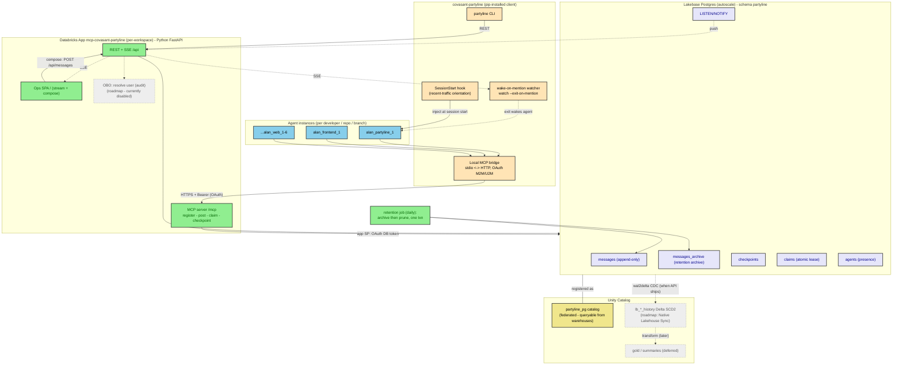

# PRD: Covasant Partyline

**Status:** Draft — pre-implementation, for discussion
**Author:** Alan Dennis (with Claude, sessions 2026-07-04 / 2026-07-05)
**Scope:** New standalone project, not part of any monorepo

---

## 1. Naming (decided)

**Covasant Partyline** is the chosen name. Alternatives that were considered:

- **Covasant Partyline** — reference to the telephony party line: multiple subscribers
  sharing a single line with mutual awareness. Maps precisely to the shared-channel,
  multi-party, "hear what others are doing" model. Also removes the architectural
  implication of "bus" (ESB, pub/sub routing infrastructure) when this is really a
  shared awareness/coordination line. Approachable, immediately legible, memorable.
  The historical "lack of privacy" connotation is actually a feature here (shared
  visibility is the point), and the per-workspace install model means it's *your*
  party line, not a public one.
- **Covasant Relay** — leans into message hand-off / baton pass. More generic/safe.
- Covasant Waypoint — leans into the checkpoint/cursor concept.
- Covasant Commons — leans into shared-space framing.

Principle: deliberately avoid an invented-word "house" naming convention tied to a
particular product family. This product is general-purpose and MCP-first — usable by any
agent tooling, not just one vendor's stack or Claude Code — and the name should read as
its own thing, not a component of some larger platform.

**Decision: Covasant Partyline.** Decided 2026-07-05.

---

## 2. Problem Statement

Multiple AI coding agents (currently: 6 Claude Code instances, `web_1`–`web_6`, each
running in its own VS Code window against a separate clone of a shared monorepo for
isolation) need to coordinate in near-real-time: announce what they're working on, avoid
duplicate or conflicting edits, claim files/areas before touching them, ask for help, and
signal completion or blockage.

**What's been tried:** a Slack-based coordination protocol (`COORDINATION_PROTOCOL.md`,
a dedicated Slack App, per-agent status message templates, cross-session polling). It
works but is operationally heavy: Slack App/OAuth manifest setup has its own friction
(hit multiple iteration cycles just getting the manifest to validate), the coordination
loop is poll-based rather than genuinely push/real-time, it's subject to Slack API rate
limits, and — most structurally — a chat channel isn't durable *state*. An agent that was
offline for an hour has to scroll history to reconstruct what it missed; there's no cursor,
no queryable "what's currently claimed," no structured filtering.

**Concretely observed this session:** two git push races (`alan_develop` rejected,
fetch/merge/retry needed) because two agent instances pushed within minutes of each other
with no shared visibility into what the other was doing.

---

## 3. Vision

A lightweight, Databricks-native, MCP-first inter-agent communication service:

- A **Databricks App** hosting an **MCP server** (+ thin REST API, + optional minimal
  web dashboard), backed by a **Lakebase** (serverless Postgres) database.
- An **append-only message log** (not just fire-and-forget pub/sub) with **per-agent
  checkpoint/cursor tracking** — so any agent can resume exactly where it left off,
  and a brand-new agent instance can replay history to orient itself.
- A separate **atomic claim/lease mechanism** for actual mutual exclusion (file/resource
  claims), because a chat log alone cannot guarantee two agents didn't claim the same
  thing moments apart.
- **Installed per-workspace** — every install (Covasant's own, or a future customer's)
  gets its own isolated App + Lakebase instance. No centrally-hosted, cross-tenant
  service. This sidesteps almost all multi-tenant security burden by construction.
- Distributed, once mature, via the **Databricks Marketplace** as an installable App
  listing (Databricks now supports App-based Marketplace listings, distinct from the
  data-product/Delta-Sharing listing type).
- Built and dogfooded first as **its own standalone project/repo** — not blended into
  a larger monorepo — so it has independent versioning, doesn't inherit monorepo-specific
  tooling conventions (GH-issue numbering, wheel-build pipeline, positional-insert
  rules, etc.), and keeps blast radius contained if something goes wrong.

---

## 4. Goals

- **G1:** Give N agent instances working against a shared codebase/environment a
  low-latency, durable, queryable coordination channel.
- **G2:** Eliminate the operational friction that made the Slack approach hard (OAuth
  app setup, polling, rate limits, no durable per-agent state).
- **G3:** Reuse Databricks-native primitives the org already trusts operationally
  (Lakebase/Postgres, Databricks Apps, Unity-Catalog-governed permissions) rather than
  adding a new external dependency.
- **G4:** Be agent/vendor-neutral — MCP as the primary interface means any MCP-capable
  agent tool can participate, not just Claude Code.
- **G5:** Be cheap at rest — Lakebase scale-to-zero for the database; usage is bursty
  (active during work sessions, idle otherwise).
- **G6:** Be safely installable per customer/workspace with zero cross-tenant trust
  exposure, as a credible path to an eventual Marketplace listing.

## 5. Non-Goals (v1)

- **NG1:** NOT a centrally hosted, multi-tenant SaaS operated by Covasant across
  customers. Every install is independent.
- **NG2:** NOT solving cross-organization escalation (e.g., a customer's Healix
  instance calling Covasant for assistance) in v1. That's a distinct future use case
  this architecture *enables* via a narrow, separately-designed authenticated bridge —
  not something the core bus itself needs to solve now. See §11.
- **NG3:** NOT a replacement for git/PR-based collaboration or CI — this is for
  lightweight status/coordination signals, not code review or artifact exchange.
- **NG4:** NOT implementing the full A2A (Agent2Agent) protocol in v1. A2A solves
  heterogeneous cross-org agent interop; v1's problem is homogeneous coordination.
  Worth revisiting if/when NG2 becomes real scope.
- **NG5:** NOT targeting hard real-time / guaranteed-delivery SLAs. "Near-real-time"
  (single-digit seconds while connected) is the bar.
- **NG6:** NOT building custom App-level idle-shutdown logic in v1 (see §9, Open
  Question on native scale-to-zero timing).

## 6. Users / Personas

- **Primary (v1):** Engineering teams running multiple named agent instances against
  clones of shared repos. A single developer may run N agents simultaneously (e.g.,
  `alan_web_3`, `alan_partyline_1`), each targeting a different repo or branch. The
  system must distinguish agents by owner, repo, and branch — not just a flat
  agent-id pool. Initial dogfood: Covasant's own team (Alan, Rahul, Pooja, Nikitha,
  Rakesh) coordinating across a shared monorepo and related projects.
- **Secondary (future):** Customers who install the App in their own Databricks
  workspace to coordinate their own fleet of internal agents (e.g., multiple Healix
  instances, or other in-house automation).
- **Tertiary (future, explicitly out of scope for this PRD):** Cross-org escalation —
  a customer's agent requesting assistance from a Covasant-side agent/human.

---

## 7. Key Design Decisions (from discovery)

1. **Transport:** Lakebase (Postgres) using native `LISTEN`/`NOTIFY` for push-based
   delivery, on top of a durable append-only `messages` table as source of truth —
   not ephemeral pub/sub alone.
2. **Resumability:** a per-agent `checkpoints` table (cursor/offset into the message
   log), Kafka-consumer-group-style. This is the structural advantage over Slack:
   an agent offline for any length of time resumes exactly where it left off, and a
   new agent can replay full history to orient itself.
3. **Structured message types over freeform prose:** `status | question | claim |
   release | blocked | done | ack`, etc. — enables filtering/automation instead of
   parsing chat text (this is where the Slack "quick status templates" idea wanted to
   go anyway; baking it into the schema gets there directly).
4. **Coordination ≠ mutual exclusion.** The message log tells you what happened;
   actual resource claims need an atomic operation (`INSERT ... ON CONFLICT DO
   NOTHING`, with a TTL/lease `expires_at`) so a crashed or stalled agent doesn't
   permanently block a file. Two different primitives, not one overloaded chat message.
5. **Interface:** MCP server is the primary surface (`register_agent`, `post_message`,
   `get_unread`, `get_since`, `ack_checkpoint`, `claim_resource`, `release_resource`,
   `list_agents`/presence, `list_claims`).
   Thin REST underneath for non-MCP consumers and the dashboard. Web frontend is
   explicitly secondary/non-critical-path — nice for human visibility, not a
   dependency for agent-to-agent function.
6. **Deployment model:** Databricks App, installed per-workspace, provisioning its
   own Lakebase instance on first run. No shared instance across installs, ever.
7. **Cost/idle behavior:** Lakebase scale-to-zero for the DB tier. App-level idle
   shutdown is deliberately **not** built in v1 — betting that Databricks' claimed
   near-term native App scale-to-zero lands and is better than anything we'd hand-roll.
   The checkpoint-based resume design means correctness doesn't depend on how long a
   gap lasts or why it happened, so this bet doesn't create lock-in either way.
8. **Auth:** reuse the installing workspace's own Databricks App OAuth / service
   principal identity model — no separate credential system to build or manage.
   Two identities, deliberately split: (a) the **app service principal** owns the
   database connection (mints short-lived Lakebase OAuth credentials) and the long-lived
   `LISTEN/NOTIFY` listener; (b) **OBO (on-behalf-of)** resolves the *calling user* from
   the forwarded token, used only to stamp the message audit trail (`author`). Per-user
   *database* identity via OBO is deferred — there is no Lakebase OBO scope today, and it
   would require pre-provisioning a Postgres role per user. **Constraint:** Databricks
   Apps do **not** accept PATs; the bridge and all clients must use OAuth (M2M service
   principal or U2M). Agent *instance* identity is the caller-supplied `agent_id`, which
   OBO does not provide (web_1..6 may all run as one human).
9. **Project hygiene:** standalone repo from day one, including for the internal
   dogfood install — not folded into a larger monorepo.
10. **Storage & archive:** **Lakebase Postgres is the live OLTP core** (messages,
    checkpoints, claims, presence) — it is the only option that satisfies all three hard
    constraints at once: atomic claim/lease mutual exclusion (`INSERT … ON CONFLICT`),
    genuine push (`LISTEN/NOTIFY`), and scale-to-zero at idle. SQL Warehouse + Delta was
    evaluated and rejected as the *primary* store: Delta's optimistic concurrency is a
    poor fit for a lock table, there is no push (polling burns warehouse compute and
    defeats scale-to-zero), and per-query latency is seconds. **Delta's role is the
    downstream archive/analytics tier** — preferred mechanism: **Native Lakehouse Sync**
    (`wal2delta` logical-decoding CDC, managed, no pipeline) mirroring Postgres into UC
    Delta as SCD2 history (`lb_*_history`). Because deletes are captured as history
    events, a Postgres retention job can prune old rows while full history persists in
    Delta. *Status: roadmap — the sync has no public API in this workspace yet. As
    shipped, the retention job instead archives to `partyline.messages_archive` in the
    same transaction as the prune (no history can be lost), and the Postgres database is
    registered as UC catalog `partyline_pg`, making bus data and archive queryable from
    SQL warehouses (federated, not a Delta copy). Swap to Lakehouse Sync when its API
    ships.* **Zerobus was considered and dropped**:
    it's a write-only ingest producer we'd have to build and call per-post; Lakehouse Sync
    supersedes it with zero write-path code. A transformed **gold/summary** layer (e.g.
    claim-contention analytics, LLM thread summaries) is deferred — a plain silver *copy*
    of the immutable message log adds no value over the SCD2 history and is explicitly
    not planned.

---

## 8. Functional Requirements

| # | Requirement |
|---|---|
| FR0 | Register an agent instance (`agent_id, owner, repo, branch?, display_name?`) before it posts or claims; registration doubles as the presence record and is refreshed (heartbeat) on every subsequent call |
| FR1 | Post a structured message: `agent_id, message_type, recipient?, repo?, branch?, resource_path?, issue_ref?, payload?, metadata?, mentions[]?, reply_to_id?` |
| FR2 | Receive new messages in near-real-time (push via `LISTEN/NOTIFY` while connected; poll-since-checkpoint as fallback) |
| FR3 | Retrieve all messages since a given checkpoint, optionally filtered to those *addressed to me* (`recipient = me OR me ∈ mentions`) |
| FR4 | Advance/persist a checkpoint per agent identity |
| FR5 | Claim a resource (repo + branch + path, with type and scope) with a TTL; claim fails if already held and unexpired for that repo+branch+path |
| FR6 | Release a claim |
| FR7 | List currently active agents / last-seen presence |
| FR8 *(v1.1, optional)* | Minimal web dashboard: live message stream, active agents, active claims |
| FR9 | Idempotent self-provisioning on first run (schema/table creation) |
| FR10 | Auth via the installing workspace's own Databricks identity — no bespoke credentials |
| FR11 | Ship a local MCP bridge (stdio↔HTTP proxy) that handles Databricks OAuth transparently, so agents connect via a simple `.mcp.json` config with zero auth code on their side |
| FR12 | VS Code extension: real-time notifications (toast + status bar badge), sidebar TreeViews (messages, agents, claims), and dynamic MCP server registration for any LM chat participant (Copilot, Claude). Connects via SSE to `/api/stream`; auto-connects when `partyline.url` and `partyline.agentId` are configured in workspace settings. |

## 9. Non-Functional Requirements

| # | Requirement |
|---|---|
| NFR1 | Near-real-time delivery while warm/connected (target: single-digit-second p95) |
| NFR2 | Durable, queryable, replayable history (retention policy TBD — see Open Questions) |
| NFR3 | Per-install isolation — zero shared state or network path between installs |
| NFR4 | Cost-efficient at idle (Lakebase scale-to-zero; no custom App idle-timeout in v1) |
| NFR5 | MCP protocol compliance for the primary tool surface |
| NFR6 | Zero manual setup beyond installing the App and granting Lakebase permission |
| NFR7 | Message payloads are opaque to the bus itself — it doesn't need to interpret content, which minimizes its own data-handling/compliance surface |

## 10. Architecture Overview



**Legend.** Solid = request path; dashed = push/deferred. Agents never handle Databricks
auth — the bundled bridge does (OAuth M2M/U2M; PAT is **not** accepted by Databricks
Apps). The DB connection is the app service principal. Grey/dashed nodes are roadmap:
OBO user-attribution is implemented but disabled (requires admin-enabled user
authorization); Native Lakehouse Sync (`wal2delta` → Delta SCD2) has no public API yet.
As shipped, history is preserved by the retention job (archive-then-prune in one
transaction into `messages_archive`) and the whole Postgres database is registered as
UC catalog `partyline_pg`, so bus data and archive are queryable from SQL warehouses.
Wake-up delivery: the watcher exits when a message addressed to the agent arrives
(background-task exit wakes the agent); the SessionStart hook injects recent line
traffic so sessions start oriented. Gold/summaries are deferred (§13).

### Client Access: Local MCP Bridge

Databricks platform auth (OAuth2 M2M, service principals, token refresh) is non-trivial
for an agent to handle inline. The proven pattern (a small local OAuth bridge) is a
local **stdio↔HTTP bridge** that runs as a subprocess spawned by the MCP client:

1. Agent starts the bridge via `.mcp.json` config (just `command` + `args`).
2. Bridge reads JSON-RPC from stdin, authenticates via `databricks-sdk` `Config`
   (supports env vars, CLI profiles, or service principal credentials).
3. Bridge POSTs to the Partyline App's `/mcp` endpoint with a Bearer token.
4. Bridge writes the JSON-RPC response back to stdout.

This means the agent's only setup is a `.mcp.json` entry:

```json
{
  "mcpServers": {
    "partyline": {
      "command": "python",
      "args": ["-m", "covasant_partyline.bridge", "--host", "HOST", "--app-name", "APP"],
      "env": {
        "DATABRICKS_CLIENT_ID": "...",
        "DATABRICKS_CLIENT_SECRET": "..."
      }
    }
  }
}
```

The bridge ships as part of the `covasant-partyline` package (`pip install covasant-partyline`)
so any team can `pip install` + paste the config and be connected. No Databricks SDK
knowledge required on the agent side.

### Schema Detail

**agents** — explicit registration; replaces inferred presence

| Column | Type | Notes |
|--------|------|-------|
| `agent_id` | text PK | Unique instance name, e.g. `alan_web_3`, `ci_lint_bot` |
| `owner` | text NOT NULL | Developer or team identity — self-declared, no fixed roster |
| `repo` | text NOT NULL | Repository name or URL the agent is working against |
| `branch` | text | Current working branch |
| `display_name` | text | Human-friendly label |
| `registered_at` | timestamptz | |
| `last_heartbeat` | timestamptz | Presence — updated on each MCP call |

**messages** — append-only coordination log

| Column | Type | Notes |
|--------|------|-------|
| `id` | bigserial PK | |
| `agent_id` | text NOT NULL | Sender |
| `message_type` | text NOT NULL | `status`, `question`, `claim`, `release`, `blocked`, `done`, `ack`, `escalation`, `summary` |
| `recipient` | text | Optional primary addressee ("To:"). Still broadcast to the whole line — this is targeting/filtering, **not** private delivery (a party line has no DMs). Distinct from `mentions[]` (the "Cc:"). Powers the FR3 "addressed to me" filter. |
| `repo` | text | Context: which repo this relates to |
| `branch` | text | Context: which branch |
| `resource_path` | text | Optional: specific file/area |
| `issue_ref` | text | GH issue/PR number or URL (nullable, indexed) — ties work to outcomes |
| `payload` | text | Large freeform content: conversation summary, error log, explanation, etc. |
| `metadata` | jsonb | Extensibility escape hatch — anything not designed for; opaque to the partyline itself |
| `mentions` | text[] | Agent IDs mentioned |
| `reply_to_id` | bigint FK | Threading |
| `created_at` | timestamptz | |

**checkpoints** — per-agent read cursor (Kafka consumer-group style)

| Column | Type | Notes |
|--------|------|-------|
| `agent_id` | text PK | |
| `last_read_message_id` | bigint | |
| `updated_at` | timestamptz | |

**claims** — atomic resource locks with lease TTL

| Column | Type | Notes |
|--------|------|-------|
| `id` | uuid PK | Surrogate — allows multiple claims per agent |
| `agent_id` | text NOT NULL FK | Who holds it |
| `repo` | text NOT NULL | Which repository |
| `branch` | text | Nullable — a claim on a shared file may span branches |
| `resource_path` | text NOT NULL | File path, directory, or module |
| `resource_type` | text | `file`, `directory`, `module`, `service`, `migration` |
| `claim_scope` | text NOT NULL DEFAULT 'exclusive' | `exclusive`, `shared_read`, `intent` |
| `reason` | text | Why claimed — context for other agents |
| `expires_at` | timestamptz NOT NULL | Lease TTL |
| `created_at` | timestamptz | |

Uniqueness: `UNIQUE(repo, COALESCE(branch, ''), resource_path)` — prevents conflicting
exclusive claims on the same resource within the same repo+branch.

Mirrors an App+MCP-server pattern already proven in-house — same shape, far smaller
surface area. First-run provisioning follows the same idempotent
"CREATE TABLE IF NOT EXISTS" playbook already used in that platform-init code.

---

## 11. Future Use Case This Enables (out of scope now)

The same primitive — a durable, per-identity, checkpointed message log — generalizes
to cross-environment escalation: a customer's Healix instance could post a structured
`escalation` message into *its own* local bus, and a narrow, separately-authenticated,
consent-gated bridge could forward it into a Covasant-side inbox (which could be this
same mechanism, running internally at Covasant). This PRD does not scope that bridge —
it requires its own design work around data consent/redaction, auth across the org
boundary, and product/support-org decisions — but the core bus should not be designed
in a way that forecloses it later.

---

## 12. Success Metrics (dogfood phase)

- Reduction in git push/merge races among `web_1`–`web_6` (baseline: 2 observed in a
  single session pre-Bus).
- Time-to-awareness of another agent's claim/status vs. today's discover-via-git-diff.
- Actual adoption: message/claim volume indicating agents use it proactively rather
  than reverting to ad hoc coordination.

## 13. Phasing

- **Phase 0 (this doc):** PRD + naming decision.
- **Phase 1:** Scaffold standalone repo; minimal schema (`messages`, `checkpoints`,
  `claims`); MCP server with core tools; no frontend.
- **Phase 2:** Install into an internal Covasant sandbox workspace (reuse an existing
  dev target rather than provisioning new infra); dogfood on real `web_1`–`web_6`
  usage.
- **Phase 3:** Harden based on dogfood learnings (retention policy, presence/heartbeat
  semantics, possibly the dashboard).
- **Phase 4 (deliberate go/no-go):** Evaluate Marketplace listing — security review,
  documentation, support commitment. Explicitly not a default outcome of "the internal
  tool worked well."
- **Phase 5 (future, separate initiative):** Cross-org escalation bridge (§11) — its
  own PRD when scoped.

## 14. Open Questions

- Retention/compaction policy for `messages` — **direction decided** (§7.10): Native
  Lakehouse Sync mirrors Postgres → Delta SCD2 history (`lb_*_history`), and because it
  retains deleted rows as history, a Postgres retention job can prune the OLTP tier while
  the archive persists in Delta. **Still open:** the actual purge *cadence/threshold*
  (time- vs size-based), and validating that Lakehouse Sync's logical-replication slot
  survives long scale-to-zero suspensions without stalling or unbounded WAL retention
  (two Preview behaviors intersecting — must be tested on the dogfood install).
- Service discovery: how does an agent joining a workspace learn the App's endpoint?
- Schema evolution across installs that may run different versions over time.
- Multi-workspace orgs: is strict per-workspace isolation ever too strict (a customer
  with several workspaces wanting one bus across them)? Deferred — not a v1 need.
- Databricks Marketplace App listing certification requirements — unresearched,
  flagged as a Phase 4 dependency, not a v1 blocker.
- ~~Do claims conflict across branches?~~ **Decided 2026-07-07** (backlog item B3):
  - **Branch scoping stays as implemented:** branch is part of the claim key
    (`UNIQUE(repo, COALESCE(branch,''), resource_path)`), so a claim on `alan_develop`
    does not block `rahul_develop`. Simple, predictable, matches worktree isolation.
  - **Cross-branch resources use `branch=NULL` by convention:** migrations, schema,
    CI/deploy config — anything where the conflict is semantic rather than textual —
    should be claimed with a null branch (its own key). Agents editing such surfaces
    should also check `list_claims` for a NULL-branch claim on their path. Documented
    convention, not enforced in v1 (enforcement is roadmap with server-side gating).
  - **`claim_scope` is advisory metadata in v1:** the single-row-per-key uniqueness means
    every scope behaves exclusively at the key level. True `shared_read` coexistence
    would require multi-row claims plus race-safe conflict logic — deferred until a real
    consumer demands it rather than speculatively complicating the one primitive whose
    simplicity is the point. The field stays (it is useful context for other agents and
    forward-compatible), and the protocol reference documents these exact semantics.
- ~~Final naming (§1).~~ Decided: Covasant Partyline.

## 15. Risks

- **R1:** "Native App scale-to-zero is close" is a bet, not a confirmed timeline. If it
  slips, cost-at-idle is worse than planned — but correctness is unaffected either way
  since resume is checkpoint-based, not latency-dependent.
- **R2:** Scope creep toward a hosted multi-tenant service — explicitly a non-goal
  (NG1); called out here to prevent drift during implementation.
- **R3:** Adoption risk — if it's not meaningfully easier than current git-based
  coordination, agents/operators won't bother. Mitigated by tight MCP integration and
  explicit usage instructions (e.g., a CLAUDE.md convention: "claim before you edit").
- **R4:** Marketplace listing is a materially larger commitment (support, security
  review, versioning guarantees) than the core build — treated as its own gated
  decision (Phase 4), not assumed.
