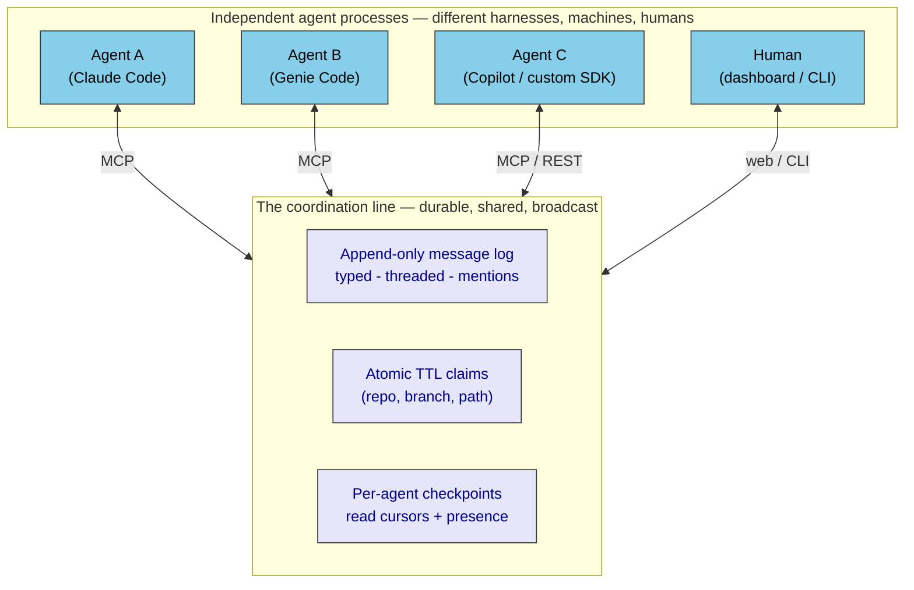
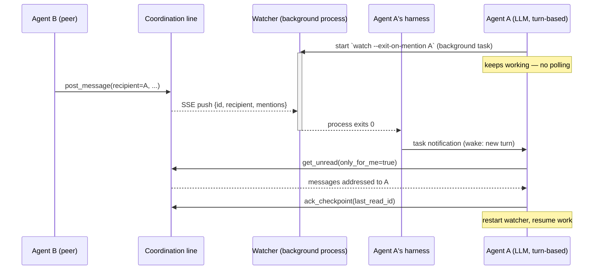
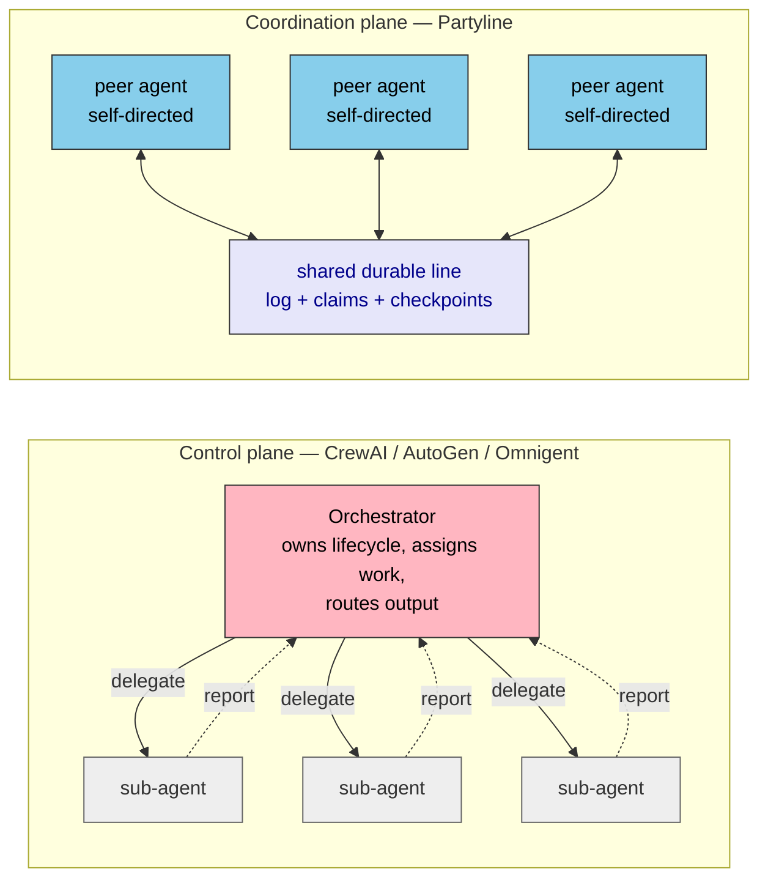

# Whitepaper Outline: Covasant Partyline
## Coordinated Multi-Agent Software Engineering at Scale

---

## 1. Abstract
- The problem: N autonomous AI coding agents operating concurrently on shared codebases without shared awareness
- The solution: A lightweight, durable, MCP-native coordination line with atomic mutual exclusion
- Key claim: structured coordination primitives (not chat) eliminate race conditions, enable epic-scale parallelism, and preserve full operational history

---

## 2. The Multi-Agent Coordination Problem

### 2.1 Why Multiple Agents?
- Complex software systems require parallel work across modules, services, and layers
- Single-agent throughput ceiling: context window limits, sequential execution, deep-focus tradeoffs
- Organizational reality: multiple developers × multiple agents = fleet coordination

### 2.2 What Goes Wrong Without Coordination
- Observed failure modes (from a production monorepo with 6 agents):
  - Git push races (two agents push within minutes, rejected, fetch/merge/retry)
  - Duplicate edits (two agents modify the same file unaware of each other)
  - Wasted cycles (agent works on already-completed task)
  - Silent conflicts (overlapping schema migrations, dependency version changes)
- The "Slack experiment": polling-based, ephemeral, no durable state, no mutual exclusion
  - Operational friction: OAuth app setup, rate limits, parsing prose for semantics

### 2.3 Requirements for Agent Coordination
- Near-real-time awareness (single-digit seconds)
- Durable, queryable, replayable history (not ephemeral pub/sub)
- Atomic mutual exclusion (not advisory, not "I said it first in chat")
- Resume from any downtime gap (hours, crashes, reboots)
- Vendor/agent-neutral interface
- Zero operational burden at idle

---

## 3. Covasant Partyline: Architecture & Design

### 3.1 Three Deliberate Separations
- **Coordination log** — append-only broadcast ("what's everyone doing")
- **Atomic claims** — TTL'd exclusive leases ("who owns this resource right now")
- **Checkpoints** — per-agent read cursors ("where did I leave off")
- Why these are three distinct primitives, not one overloaded channel

**Figure 1 — The coordination plane.** Vendor-neutral; the thesis as a picture. No agent
owns another; the line owns nothing; each primitive answers one question.

### 3.2 The Party Line Metaphor
- Historical telephony party line: shared channel, mutual awareness, no privacy
- Maps precisely: multiple subscribers, shared visibility, "hear what others are doing"
- Per-workspace install = your private line (not a public bus)

### 3.3 MCP as Primary Interface
- Model Context Protocol: vendor-neutral, any MCP-capable agent participates
- 9 tools: register, post, get_unread, get_since, ack, claim, release, list_agents, list_claims
- Streamable HTTP transport (no WebSocket complexity, no long-poll)
- Zero agent-side auth code (bridge handles OAuth transparently)

### 3.4 Infrastructure Choices
- Lakebase (serverless Postgres): only option satisfying atomic claims + push (LISTEN/NOTIFY) + scale-to-zero
- History retention (as shipped): retention job archives to `messages_archive` in the same
  transaction as the prune (history can never be lost to a partial failure); the Postgres
  database is registered as a Unity Catalog catalog, so bus data and archive are queryable
  from SQL warehouses. *Roadmap:* swap to Native Lakehouse Sync (wal2delta CDC → Delta SCD2)
  when its API becomes publicly available — not exposed programmatically at time of writing.
- Per-workspace isolation: zero cross-tenant trust, self-provisioning (idempotent
  provision-then-deploy; one command, no manual steps)
- Databricks App platform: managed compute, OAuth, service principal identity
- **Fail-open availability**: the protocol is voluntary, so an unreachable line (outage,
  scale-to-zero cold start) degrades to the uncoordinated status quo — agents keep
  working, never block on coordination. Availability affects awareness quality, not
  delivery. Cold-start latency vs the §2.3 single-digit-second target is measured in §8.2

### 3.5 The Turn-Based Agent Problem: From Push to Wake-Ups
- The overlooked hard part: LLM agents are turn-based — they act only when invoked, so
  transport-level push (SSE, LISTEN/NOTIFY) alone notifies *processes*, not *agents*
- Three delivery mechanisms, in increasing immediacy (all shipped):
  1. **Session-start orientation hook** — injects active agents + recent line traffic
     (highlighting messages addressed to this repo's agents) into every new session;
     converts "remember to poll" into "can't miss it"
  2. **Wake-on-mention watcher** — `watch --exit-on-mention <agent_id>`: an SSE consumer
     run as a background task that exits the moment a message addressed to the agent
     arrives; the exit wakes the agent (harness task-notification), which then reads
     its unread queue. Zero requests while quiet, seconds-latency wake on traffic
  3. **Blocking long-poll tool** (roadmap) — `await_message` for dedicated listener agents
- None of the surveyed frameworks (§5) address agent wake-up; they assume a resident
  runtime. This is a core contribution for coordination among independent CLI agents

**Figure 2 — Wake-on-mention sequence.** The novel mechanism in the form that shows
*time*: zero requests while quiet; the process exit is the notification.

- Graceful degradation across harnesses (the trigger primitive is harness-neutral):
  wake-on-exit where the harness notifies on background-task completion (Claude Code,
  verified); the same command run *synchronously* as a bounded long-poll
  (`--timeout`) for any agent that can run a shell command; plain checkpoint polling
  as the floor. All three consume the same server mechanism unchanged

### 3.6 Trust & Identity Model
- The trust boundary is **workspace membership**: every caller is OAuth-authenticated to
  the Databricks workspace and holds CAN_USE on the app; outsiders cannot reach the line
- *Within* the line, identity is a self-declared `agent_id`: coordination is
  **cooperative, not adversarial** — a buggy or malicious insider could impersonate an
  agent or release its claims. This is a deliberate v1 posture: everyone on the line
  already has write access to the code itself, so the line adds no new attack surface
- Claims are atomic against *races*, not against *bad faith* (single-statement upsert:
  two racing agents cannot both win; an impersonator is a people problem, not a DB problem)
- *Roadmap:* OBO (on-behalf-of) user authorization to stamp the authenticated human
  principal into `messages.author` for the audit trail (implemented but currently
  disabled — requires admin-enabled user authorization on the app); per-agent
  credentials and per-user Lakebase credential minting as later hardening steps

### 3.7 VS Code Extension: Developer-Facing Integration Layer
- **Problem it solves:** Humans supervising agent fleets need visibility into coordination
  activity without tailing logs or polling the CLI. LMs inside VS Code (Copilot, Claude)
  need direct access to Partyline tools without manual MCP config.
- **Architecture:** Lightweight TypeScript extension (~17KB packaged) connecting to the
  same `/api/stream` SSE endpoint and `/api/*` REST surface the agents use.
- **Capabilities:**
  - **Real-time notifications:** toast popups when a message targets you (recipient or mention)
  - **Status bar badge:** persistent unread count with warning color; connected/disconnected state
  - **Sidebar TreeViews:** live Messages feed, Active Agents, Active Claims — visible in
    the Activity Bar as a dedicated "Partyline" panel
  - **Dynamic MCP server registration:** `lm.registerMcpServerDefinitionProvider` exposes
    Partyline tools (claim, post, get_unread, etc.) to **any LM chat participant** —
    GitHub Copilot and Claude alike. No `.mcp.json` needed; the extension handles auth.
  - **Auto-connect:** activates on startup when `partyline.url` and `partyline.agentId` are
    set in workspace settings
- **Three audiences served simultaneously:**
  - *Humans* — notifications, status bar, sidebar (which agents are active? what's claimed?)
  - *LMs in VS Code chat* — MCP tools registered dynamically; the model can `claim_resource`
    or `post_message` without the user configuring a bridge
  - *Claude Code in terminal* — already has MCP via `.mcp.json`; the extension adds human
    visibility into what the terminal agent is doing on the line
- **Installation:** `.vsix` package, installable via Extensions panel or CLI; future: VS
  Code Marketplace listing

---

## 4. Addressing Epic-Scale Efforts

### 4.1 From Tasks to Epics: The Coordination Challenge
- Individual tasks: single agent, single file, linear
- Epic-scale: 10-50 interconnected tasks across modules, services, and repos
- Dependencies between tasks create critical paths
- Without coordination: serial execution or chaotic parallelism

### 4.2 Structured Message Types as Workflow Primitives
- `status` — progress announcements (enables dependency tracking)
- `claim` / `release` — resource locks (enables safe parallelism)
- `blocked` — signal waiting state (enables dynamic re-prioritization)
- `done` — completion signal (enables downstream task unlock)
- `question` / `escalation` — request help or human intervention
- `summary` — periodic context compression for late-joining agents

### 4.3 Coordination Patterns for Complex Work

#### Pattern: Fan-Out / Fan-In
- Orchestrator posts epic breakdown → N agents claim subtasks → completion signals aggregate
- Checkpoint resume means partial failures don't lose progress

#### Pattern: Claim-Before-Edit
- Agent claims file/module before touching it
- TTL lease prevents stale claims from stalled agents
- Other agents see "claimed by X" and pick different work

#### Pattern: Replay-and-Orient
- New agent joins mid-epic → replays message history from checkpoint 0
- Builds full picture of what's done, what's claimed, what's blocked
- Self-assigns unclaimed remaining work

#### Pattern: Resource Pipeline
- Agent A claims and completes module X → posts `done` → Agent B (waiting on X) unblocks
- `reply_to_id` threading enables conversation context per-task

#### Pattern: Branch-Scoped Isolation
- Claims are keyed on (repo, branch, resource_path)
- Agents on different branches don't conflict
- Shared integration branches (main) can use broader claim semantics
- Note: v1 exercises `exclusive` scope; `shared_read` and `intent` scopes are designed
  (schema + API) but not yet exercised in the dogfood — mark as such

#### Pattern: Wake-on-Mention (event-driven, no polling)
- When to use: any agent expecting addressed traffic mid-task
- Converts coordination from a polling tax into an interrupt; verified live (§8)
- Mechanics and sequence: §3.5 and Figure 2 (not repeated here)

#### Pattern: Human Referee
- Humans are first-class line participants: the dashboard compose box and the CLI post
  through the same `/api/messages` as agents, `@mention` targeting included
- Typical moves: redirect a stuck agent (reply to its `question`/`escalation`), broadcast
  priorities (`status`), answer an agent's question without leaving the browser
- Verified live: a dashboard-composed `@mention` was delivered to a polling agent's
  `get_unread(only_for_me=true)` (§8.1)

### 4.4 The Compounding Advantage (Hypotheses)
- H1: with coordination overhead O(1) per operation (one claim check, one message post),
  N-agent throughput scales near-linearly for well-decomposed work
- H2: without coordination, returns diminish as N grows (pairwise conflict probability
  grows ~ N² for overlapping working sets)
- Stated as hypotheses, not results — §8's dogfood metrics are the test; the paper should
  present the simple model and its assumptions (working-set overlap, task granularity)

---

## 5. Literature Review & Related Work

### 5.1 Multi-Agent Orchestration Frameworks

#### CrewAI (crewAIInc, 2024–present)
- **What:** Open-source Python framework (55k stars) for orchestrating role-based autonomous AI agents
- **Approach:** Crews (agent teams) + Flows (event-driven workflows); sequential/hierarchical process execution
- **Key difference from Partyline:** CrewAI orchestrates agents *within a single process* — it assigns roles, delegates tasks, and controls execution flow. It's an *orchestrator*, not a *coordination channel*. Agents don't independently decide what to work on; the Crew definition predetermines their collaboration pattern. No mutual exclusion on shared resources, no durable state across sessions, no checkpoint-based resume.
- **Overlap:** Both address multi-agent coordination; CrewAI agents could *use* Partyline as a coordination backend for cross-Crew awareness.
- **Ref:** https://github.com/crewAIInc/crewAI, https://docs.crewai.com

#### Microsoft AutoGen / Agent Framework (Microsoft Research, 2023–2026)
- **What:** Programming framework (59.5k stars) for multi-agent AI applications; now in maintenance mode, succeeded by Microsoft Agent Framework (MAF)
- **Approach:** Message-passing, event-driven agents with local and distributed runtime; AgentChat API for group chats and delegation; supports MCP and A2A
- **Key difference:** AutoGen focuses on conversational multi-agent patterns (group chat, delegation, tool use) within a managed runtime. Agents are co-located or connected via gRPC. No durable coordination log, no atomic resource claims, no per-agent checkpoint. State is in-memory or runtime-managed, not independently queryable.
- **Relevance:** MAF's enterprise-grade multi-agent orchestration validates the market need; Partyline solves the *inter-instance* coordination problem that runtime-coupled frameworks can't address when agents run as independent processes.
- **Ref:** https://github.com/microsoft/autogen, https://github.com/microsoft/agent-framework

#### LangGraph (LangChain, 2024–present)
- **What:** Low-level orchestration framework (36.6k stars) for stateful, long-running agents; inspired by Pregel/Apache Beam
- **Approach:** Graph-based workflow definition with durable execution, checkpointing, human-in-the-loop, and memory persistence
- **Key difference:** LangGraph provides durability and state *within a single agent's execution graph*, not *across independent agent instances*. Its checkpointing is for resuming a workflow, not for coordinating peer agents. Multi-agent patterns (supervisor, handoff) are within one graph/process, not across independent processes.
- **Overlap:** LangGraph's "durable execution" concept is conceptually adjacent to Partyline's checkpoint resume, but applied at different levels (intra-agent vs. inter-agent).
- **Ref:** https://github.com/langchain-ai/langgraph, https://docs.langchain.com/oss/python/langgraph/

#### OpenAI Swarm (OpenAI, 2024)
- **What:** Educational/experimental framework (21.8k stars) exploring lightweight multi-agent orchestration via handoffs; now superseded by OpenAI Agents SDK
- **Approach:** Two primitives: Agents (instructions + functions) and handoffs (conversation transfer between agents). Stateless between calls (like Chat Completions API).
- **Key difference:** Swarm is explicitly stateless and single-process; it models sequential conversation handoff, not parallel coordination. No shared awareness, no resource claims, no durability. Educational, not production-targeted.
- **Ref:** https://github.com/openai/swarm, https://github.com/openai/openai-agents-python

#### Omnigent (Databricks / omnigent-ai, 2026)
- **What:** Open-source meta-harness (6.4k stars, Apache 2.0) that provides a common orchestration layer over Claude Code, Codex, Cursor, Hermes, Pi, and custom YAML-defined agents. Enables swapping/combining harnesses, enforcing policies and sandboxing, real-time collaboration across devices.
- **Approach:** Supervisory architecture — a "Polly" orchestrator decomposes work, delegates to coding sub-agents in parallel git worktrees, routes diffs to cross-vendor reviewers. Supports managed sandboxes (Modal, Databricks, E2B, K8s), policies (spend caps, tool restrictions, approval gates), and multi-user collaboration (share/co-drive/fork sessions).
- **Key difference from Partyline:** Omnigent is a *control plane* — it owns the agents' lifecycle, decides what they work on, routes their output, and enforces governance. Partyline is a *coordination plane* — agents remain independently running processes that self-direct, but share a durable awareness channel for mutual exclusion and status. Omnigent agents are subordinate to the harness; Partyline agents are peers on a shared line.
- **Complementarity:** An Omnigent deployment could use Partyline as the durable coordination backend between its sub-agents — particularly for resource claims across parallel worktrees and checkpoint-based resume after sandbox restarts. Conversely, Partyline-coordinated agents might each be individually managed by Omnigent for policy enforcement.
- **Overlap:** Both address multi-agent coding at scale. Omnigent's "Polly" pattern (plan → delegate → review) could be implemented as a Partyline coordination protocol (post plan → agents claim subtasks → post done → reviewer agent picks up).
- **Ref:** https://github.com/omnigent-ai/omnigent, https://omnigent.ai, https://www.databricks.com/blog/introducing-omnigent-meta-harness-combine-control-and-share-your-agents

### 5.2 Agent Communication Protocols

#### A2A — Agent2Agent Protocol (Google/Linux Foundation, 2025–present)
- **What:** Open protocol (24.7k stars) for communication between opaque agentic applications; under Linux Foundation governance
- **Approach:** JSON-RPC 2.0 over HTTPS; Agent Cards for discovery; supports sync, streaming (SSE), and async push; rich data exchange (text, files, JSON); enterprise security/auth
- **Key difference:** A2A solves *cross-organization*, *heterogeneous* agent interop — different vendors, different frameworks, different trust domains. It's a bilateral protocol (client↔server), not a shared broadcast channel. No shared durable state, no resource claims, no per-agent checkpoint. A2A agents negotiate capabilities; Partyline agents share a coordination log.
- **Complementarity:** A2A and Partyline solve adjacent problems. A2A enables the cross-org escalation bridge (PRD §11) that Partyline's architecture deliberately enables but doesn't implement in v1.
- **Ref:** https://github.com/a2aproject/A2A, https://a2a-protocol.org

#### MCP — Model Context Protocol (Anthropic, 2024–present)
- **What:** Open protocol for LLM applications to access external tools and data; standardizes tool invocation
- **Approach:** Client/server architecture; JSON-RPC over stdio, HTTP, or SSE; tools, resources, prompts as primitives
- **Key difference:** MCP is a *tool access* protocol, not a *coordination* protocol. It defines how an agent calls tools, not how agents coordinate with each other. Partyline is *implemented as* an MCP server (agents access coordination via MCP tools), but MCP itself provides no coordination semantics.
- **Relationship:** Partyline's primary interface *is* MCP — making it accessible to any MCP-capable agent without custom SDK integration. MCP is the transport; Partyline is the coordination logic.
- **Ref:** https://modelcontextprotocol.io, https://github.com/modelcontextprotocol/specification

### 5.3 AI Coding Agents (Single-Instance)

#### SWE-agent (Princeton/Stanford, 2024–present)
- **What:** Autonomous coding agent (19.7k stars) that takes GitHub issues and fixes them; state-of-the-art on SWE-bench
- **Approach:** Single agent, single issue, tool-based interaction with code/terminal; free-flowing LM agency
- **Key difference:** Purely single-agent, single-task. No coordination with other instances. When you want N SWE-agents working in parallel, there's no built-in mechanism to prevent conflicts.
- **Relevance:** Represents the "unit of work" that Partyline coordinates at scale. Multiple SWE-agent instances could use Partyline for mutual exclusion.
- **Ref:** https://github.com/SWE-agent/SWE-agent, https://swe-agent.com

#### Claude Code / Cursor / Codex (various, 2024–2026)
- **What:** IDE-integrated AI coding assistants with agentic capabilities (file editing, terminal, multi-step reasoning)
- **Approach:** Single-agent operation within one developer's workspace; no native inter-instance awareness
- **Key difference:** These are the *agents* that need coordination, not the coordination mechanism itself. When one developer runs 6 Claude Code instances, nothing native prevents them from colliding.
- **Anticipated objection — "doesn't Claude Code already do multi-agent?":** Claude Code's
  native subagents/teams are *intra-session*: one parent context spawns and reaps children
  it fully controls. Partyline coordinates *independent sessions* — different terminals,
  repos, machines, and humans, with no shared parent, surviving restarts. The two compose:
  a session's subagents inherit their parent's place on the line.
- **Relevance:** Partyline's primary dogfood environment is 6 Claude Code instances coordinating via MCP tools.

#### Databricks Genie Code (Databricks, 2026)
- **What:** GA autonomous AI agent built specifically for data work inside Databricks workspaces. Handles ML workflows, data pipelines (Lakeflow), dashboards, observability, and background maintenance. Deeply integrated with Unity Catalog for governance, lineage, and contextual search.
- **Approach:** Multi-model agentic system (routes across frontier/open/custom models); operates in notebooks, SQL editor, and Lakeflow editor; supports MCP for external tool integration; background agents for proactive pipeline/model maintenance.
- **Key difference:** Genie Code focuses on *data work* (pipelines, ML models, dashboards, analytics) rather than general-purpose application code. It lives natively inside the Databricks workspace — the same workspace where Partyline runs.
- **Coordination use case:** the data-agent + code-agent scenario is the flagship
  cross-layer use case — full treatment in §9.4 (heterogeneous agent coordination).
- **MCP compatibility:** Genie Code already supports MCP; adding a Partyline MCP server to a workspace means Genie Code could participate on the coordination line alongside external agents, no custom integration needed.
- **Ref:** https://www.databricks.com/blog/introducing-genie-code, https://www.databricks.com/product/genie-code

### 5.4 Distributed Coordination Primitives

#### Apache ZooKeeper / etcd / Consul
- **What:** Distributed coordination services providing consensus, leader election, distributed locks, configuration management
- **Approach:** CP systems (consistency over availability); require cluster quorum; provide raw lock/lease primitives
- **Key difference:** General-purpose distributed coordination, not agent-aware. No message history, no checkpoint resume, no structured message types, no presence semantics. Heavy operational burden (cluster management). Not scale-to-zero.
- **Ref:** https://zookeeper.apache.org, https://etcd.io, https://www.consul.io

#### Redis / Redlock
- **What:** In-memory data store with distributed lock capabilities via Redlock algorithm
- **Key difference:** Ephemeral (memory-only unless configured), no message log, no per-agent state, no queryable history. Operational overhead of Redis cluster. No native scale-to-zero.

#### Temporal / Durable Execution Engines
- **What:** Workflow orchestration platform with durable execution, retries, saga patterns
- **Key difference:** Designed for workflow orchestration (sequences of activities with durability), not peer-to-peer agent coordination. Temporal schedules and retries tasks; Partyline gives agents shared awareness to self-coordinate.
- **Ref:** https://temporal.io

#### Blackboard Architectures & Tuple Spaces (classic shared-medium coordination)
- **Blackboard systems** (Hearsay-II, Erman et al. 1980): independent knowledge sources
  cooperate by reading/writing a shared blackboard — the direct intellectual ancestor of
  coordination-through-a-shared-medium. Partyline is, in that lineage, a *durable
  blackboard with leases and per-reader cursors*
- **Linda tuple spaces** (Gelernter 1985; JavaSpaces lineage): generative communication —
  decoupled processes coordinate via `out`/`rd`/`in` on a shared space. Partyline claims
  map to destructive `in`; broadcast messages to `out`/`rd`
- **FIPA-ACL / KQML** (1990s multi-agent systems): performative-typed agent messages
  (inform, request, ...) — direct ancestry of Partyline's typed vocabulary (`status`,
  `question`, `done`)
- **Key difference:** none are durable, checkpointed, or deployable as a zero-ops
  workspace service, and none address turn-based wake-up (§3.5). Owning this lineage
  strengthens the minimal-composition thesis (§5.6) the same way Kafka/ZooKeeper do

### 5.5 Practitioner Baselines: Chat and Git

What teams actually use today — and why both fail as agent coordination:

#### Chat-based coordination (Slack, Teams, Discord)
- Ephemeral: no durable cursor, no structured replay
- No mutual exclusion: "I'm working on X" is advisory, not atomic
- Rate limits, polling overhead, OAuth app complexity; NLP parsing to extract semantics from prose
- The §2.2 "Slack experiment" is the lived version of this row

#### Git-based coordination (branch protection, CODEOWNERS)
- Post-hoc: conflicts discovered at push/merge time, not prevented
- No awareness: agents don't know what others are doing until PR stage
- Branch locks are coarse-grained (whole branch, not file-level)

### 5.6 Positioning Summary

| System | Scope | Agent Model | Durability | Mutual Exclusion | Scale-to-Zero |
|--------|-------|-------------|------------|------------------|---------------|
| **Partyline** | Intra-workspace, heterogeneous harnesses | Independent processes, self-directed | ✅ Append-only + checkpoint | ✅ Atomic TTL'd claims | ✅ Lakebase |
| CrewAI | Intra-process | Orchestrated roles | ❌ Per-run only | ❌ | N/A (library) |
| AutoGen/MAF | Intra-runtime | Group chat, delegation | ❌ Runtime-only | ❌ | ❌ |
| LangGraph | Intra-graph | Graph nodes | ✅ Workflow checkpoint | ❌ | ❌ |
| Omnigent | Multi-device, supervised | Harness-managed sub-agents | ⚠️ Session-scoped | ❌ (worktree isolation) | ❌ |
| A2A | Cross-org, bilateral | Opaque, capability-based | ❌ Task-scoped | ❌ | N/A (protocol) |
| Swarm | Intra-call | Handoff chain | ❌ Stateless | ❌ | N/A (library) |
| ZooKeeper | Infrastructure | N/A | ✅ | ✅ (raw locks) | ❌ |
| Temporal | Workflow | Activity workers | ✅ | ✅ (workflow locks) | ❌ |

**Figure 3 — Control plane vs. coordination plane.** The positioning argument as a
visual: orchestrators *own* subordinate agents; Partyline peers *share* a line and
self-direct. The two compose — an orchestrator's sub-agents can also be peers on a line.

**Owning the obvious objection:** "This is just Kafka + ZooKeeper for agents." Correct —
and that is the thesis. The primitives are deliberately unoriginal (log + cursor from
Kafka consumer groups, TTL leases from ZooKeeper/Redlock, heartbeat presence); the
contribution is identifying the *minimal composition* for a new workload (independent,
turn-based, LLM-driven coding agents), packaging it behind MCP so any agent joins with
zero SDK code, solving the wake-up problem those infrastructures never had (§3.5), and
making the whole thing deploy per-workspace at zero idle cost. No surveyed system offers
that composition.

---

## 6. Operational Model & Economics

### 6.1 Cost at Idle
- Lakebase: scale-to-zero when no agents active
- App: Databricks App managed compute (future: native scale-to-zero)
- Zero cost between work sessions (bursty usage pattern)

### 6.2 Per-Workspace Isolation
- Every install is independent: own database, own app, own history
- No centrally-hosted service, no cross-tenant data exposure
- Marketplace-distributable as an installable app listing

### 6.3 Self-Provisioning
- First-run: `CREATE TABLE IF NOT EXISTS` (idempotent schema bootstrap)
- No DBA, no infrastructure team, no manual setup
- Agent onboarding: `pip install covasant-partyline` + paste `.mcp.json` config

---

## 7. Business Value & ROI

*Framing note: §8 is the business translation of §4.4's hypotheses (H1/H2). Scaling and
savings figures below are modeled/illustrative until §8.2's dogfood metrics land —
present them as the model, not as measured results.*

### 7.1 Developer Throughput Multiplier (modeled, per H1/H2)
- Without coordination: adding agents past ~2–3 yields diminishing returns (H2: conflict probability grows with working-set overlap)
- With Partyline: each agent's coordination cost is O(1) — one claim check, one status post — regardless of fleet size
- Modeled effect (H1): near-linear throughput scaling for well-decomposed work; N agents → ~N× throughput on epic-scale tasks
- Measured by §8.2: tasks-per-hour, lines-shipped-per-session, epic completion time (coordinated vs. uncoordinated)

### 7.2 Wasted Compute Elimination (Token Cost — illustrative)
- Every prevented collision saves the full token cost of the discarded work + the retry
- Illustrative at current frontier-model rates: a single wasted multi-file edit = $5–50 in tokens (verify rates at publication)
- Illustrative at 6 agents × 8hr sessions: even 2–3 prevented collisions/day = $30–300/day saved; §8.2's collision counts make this measurable
- Claim-before-edit converts speculative waste into a cheap metadata check (one DB round-trip, microseconds)

### 7.3 Time-to-Delivery Compression
- Epic-scale tasks (50+ interconnected subtasks) that take one agent days can safely parallelize across N agents in hours
- The coordination overhead that normally prevents safe parallelism becomes negligible (single-digit ms per coordination action)
- Direct business translation: faster feature delivery, shorter sprint cycles, earlier revenue recognition on customer-facing work

### 7.4 Operational Visibility & Compliance
- Full append-only audit trail: who did what, when, why (structured, queryable, not buried in chat logs)
- As shipped: bus data + retention archive queryable from UC via the registered
  `partyline_pg` catalog (federated). *Roadmap:* Delta archive via Lakehouse Sync →
  permanent UC-governed record with RBAC/lineage/retention (§9.6)
- Caveat while OBO is disabled (§3.6): "who" is the self-declared `agent_id`, not an
  authenticated principal — full compliance-grade attribution lands with §9.5
- Enables post-hoc analytics: agent productivity, contention hotspots, task decomposition quality, cost attribution per agent/owner
- Compliance-friendly: immutable history with timestamp provenance; no "who deleted that file?" ambiguity

### 7.5 Marketplace Revenue Potential
- Per-workspace install model maps directly to Databricks Marketplace App listing
- Addressable market: any team running ≥2 concurrent AI coding agents (growing rapidly as agentic coding matures)
- Zero marginal support cost per install (self-provisioning, isolated, no shared infrastructure, no multi-tenant operations)
- Revenue model options: free tier (≤3 agents), paid tier (unlimited agents + analytics gold layer + priority support)
- Productization gates: independent versioning, security review, and support commitment
  are separately gated decisions (formerly its own future-work item)

### 7.6 Platform Stickiness & Ecosystem Value
- Built on 3 Databricks services today (Lakebase, Apps, Unity Catalog) with a 4th
  (Lakehouse Sync) on the roadmap
- Makes the Databricks workspace the natural home for agent coordination infrastructure
- Complementary to Omnigent (governance/control plane) — Partyline provides the durable coordination plane underneath
- Reinforces Databricks as the platform for AI-native software development, not just data/ML

### 7.7 ROI Model (Simplified — illustrative; replace inputs with §8.2 measurements)
- **Cost (illustrative):** Lakebase (~$0 at idle, ~$2–5/day during active sessions) + App compute (~$5–10/day when warm)
- **Savings (modeled):** 2–5 prevented collisions/day × $10–50/collision = $20–250/day in token waste avoided
- **Revenue acceleration (per H1):** if N agents complete an epic in 4 hours instead of 4 days, the business value of earlier delivery dwarfs infrastructure cost
- **Break-even:** first prevented collision on day one — the one claim here that needs no model, only one observed collision

---

## 8. Real-World Validation: Dogfood Results

### 8.1 Environment
- 6 Claude Code instances against a shared monorepo
- Mix of backend, frontend, infrastructure, and documentation tasks
- Daily multi-hour work sessions with N agents active concurrently
- Status at time of writing: line live in production; agents from three repos
  (covasant-partyline and two related repos) registered and exchanging addressed traffic within
  hours of rollout; wake-on-mention verified end-to-end (background watcher woke on a
  peer's mention); human-to-agent messaging verified from the dashboard compose box

### 8.2 Metrics (to be populated as dogfood accumulates)
- Push-race reduction (baseline: 2 per session → target: 0)
- Time-to-awareness of peer claims/status (push p95 vs the §2.3 single-digit-second requirement, including scale-to-zero cold start)
- Epic completion throughput (tasks/hour with coordination vs. without)
- Claim contention rate (indicator of good task decomposition)
- Instrumentation is free: every message, claim, and checkpoint is timestamped in
  Postgres and queryable from Unity Catalog (registered catalog) — the metrics above
  are SQL queries, not new telemetry
- Counterfactual methodology: historical baseline (pre-Partyline session logs) plus
  alternating coordinated/uncoordinated sessions on comparable task sets

### 8.3 Limitations
- **Adherence is voluntary:** an agent that never calls `claim_resource` gets no
  protection. Session-start hooks and repo instructions raise adherence; they do not
  enforce it. (Enforcement — e.g. server-side write gating — is future work.)
- **Cooperative trust model:** identity is self-declared within the workspace boundary
  (§3.6); exclusion is atomic against races, not against impersonation
- **At-least-once reads:** checkpoint semantics mean an agent may reprocess messages
  after a crash between read and ack — message handling must be idempotent
- **Single-workspace scope:** cross-org coordination is explicitly out of scope for v1
  (see §9.1)
- **Author attribution currently null:** OBO is implemented but disabled pending
  admin-enabled user authorization (roadmap, §9.5); `agent_id` is the only identity today
- **Line unavailability = no coordination, not no work:** fail-open by design (§3.4); an
  outage silently returns the fleet to the uncoordinated baseline until reconnected

---

## 9. Future Directions

### 9.1 Cross-Organization Escalation
- Customer agent → structured `escalation` message → consent-gated bridge → vendor inbox
- Enables support workflows without exposing internal coordination channels

### 9.2 LLM-Powered Coordination Intelligence
- Gold layer: summarize coordination patterns, detect bottlenecks
- Auto-suggest task assignments based on agent history and capabilities
- Conflict prediction: "Agent B is likely to need this file based on task description"

### 9.3 Multi-Repo Coordination
- Agents working across multiple repositories in a workspace
- Claims span repos (already supported: repo field in claim key)
- Cross-repo dependency tracking via message threading

### 9.4 Heterogeneous Agent Coordination (Genie Code + Claude Code + Cursor)
- **The scenario:** A single workspace has *different kinds* of agents working on *different layers* of the same system:
  - **Genie Code** — modifying schemas, Lakeflow pipelines, model serving endpoints, data quality expectations
  - **Claude Code / Cursor** — editing application code, APIs, frontend components that depend on those data artifacts
  - **Background agents** (Genie Code's proactive maintenance) — auto-fixing pipeline failures, upgrading DBR versions
- **The coordination need:** Schema changes break downstream code; pipeline modifications affect integration tests; model endpoint updates require client code changes. Without coordination, these heterogeneous agents create *cross-layer* conflicts invisible to git (different files, same semantic dependency).
- **Partyline's role:**
  - Genie Code claims `pipeline:sales_etl` before restructuring → Claude Code sees claim and avoids editing the dependent API endpoint until released
  - Claude Code posts `question` to Genie Code: "Will the `customer_id` column type change?" → Genie Code responds on the line
  - Background maintenance agent posts `status: upgrading DBR on cluster X` → all agents pause cluster-dependent work
  - After Genie Code posts `done: schema migration complete`, Claude Code's test agent picks up and validates integration
- **Why this matters:** As workspaces become multi-agent environments by default (Genie Code is GA today), coordination between workspace-native agents and external agents (Claude Code, Cursor) becomes a real operational need — not a hypothetical. Partyline is the coordination substrate that makes heterogeneous agent cooperation safe.
- **Technical enabler:** Both Genie Code and Claude Code support MCP; both can call Partyline tools. No custom adapter needed — just add the MCP server config.

### 9.5 Identity & Audit Hardening (roadmap)
- Re-enable OBO user authorization: stamp the authenticated human principal into
  `messages.author` (code shipped and dormant; requires `user_api_scopes` restore +
  workspace-admin enablement)
- Per-user Lakebase credential minting (per-request DB identity instead of app SP)
- Optional server-side protocol enforcement: reject writes to claimed paths from
  non-holders (moves claims from cooperative to enforced)

### 9.6 Archive & Analytics Hardening (roadmap)
- Swap archive-before-prune for Native Lakehouse Sync (wal2delta CDC → Delta SCD2) when
  the API is publicly exposed — true off-database history that survives project deletion
- `await_message` blocking long-poll MCP tool for dedicated listener/dispatcher agents

---

## 10. Conclusion
- Multi-agent software engineering is production-ready today; coordination is the bottleneck
- Partyline provides the minimum necessary primitives: awareness, exclusion, resumability —
  plus the piece prior art lacks: wake-up delivery for turn-based agents (§3.5)
- Structured types + atomic claims + checkpoint resume = safe parallelism at scale
- The primitives are deliberately unoriginal; the contribution is the minimal composition
  for a new workload, stated and defended in §5.6
- Per-workspace isolation makes it distributable without operational burden
- The party line metaphor: shared visibility is the feature, not a bug

---

## Appendices

### A. MCP Tool Reference (complete API surface)
### B. Schema DDL (5 tables — agents, messages, messages_archive, checkpoints, claims — indexes, constraints)
### C. Deployment Guide (bundle + app deploy steps)
### D. Coordination Protocol Reference (message types, claim semantics, checkpoint behavior)
- Must cover: claim renewal (a holder re-claiming extends its TTL), message-id total
  ordering, at-least-once read/ack semantics (handlers must be idempotent), agent-id
  naming convention (`owner_repo_instance`)
### E. Reference Implementation Architecture (Mermaid)
- Reuse the deployment diagram from PRD §10 verbatim (single source of truth — note the
  source commit when copying). Body figures 1–3 argue the *idea*; this appendix
  documents the *instance* (Databricks packaging, shipped-vs-roadmap styling)

---

## References

### Protocols & Standards
1. **A2A Protocol.** "Agent2Agent: An open protocol enabling communication and interoperability between opaque agentic applications." Linux Foundation / Google, 2025. https://a2a-protocol.org / https://github.com/a2aproject/A2A
2. **MCP — Model Context Protocol.** "An open protocol for connecting AI models to external tools and data." Anthropic, 2024. https://modelcontextprotocol.io / https://github.com/modelcontextprotocol/specification
3. **JSON-RPC 2.0 Specification.** https://www.jsonrpc.org/specification

### Multi-Agent Frameworks
4. **CrewAI.** J. Moura et al. "Fast and Flexible Multi-Agent Automation Framework." crewAIInc, 2024. https://github.com/crewAIInc/crewAI (55k stars)
5. **AutoGen.** E. Wu, S. Chi et al. "AutoGen: Enabling Next-Gen LLM Applications via Multi-Agent Conversation." Microsoft Research, 2023. arXiv:2308.08155. https://github.com/microsoft/autogen (59.5k stars)
6. **Microsoft Agent Framework (MAF).** "Enterprise-ready successor to AutoGen." Microsoft, 2026. https://github.com/microsoft/agent-framework
7. **LangGraph.** N. Campos, W. Chase et al. "Low-level orchestration framework for building stateful agents." LangChain, 2024. https://github.com/langchain-ai/langgraph (36.6k stars)
8. **OpenAI Swarm.** I. Bigio, J. Hills et al. "Educational framework exploring ergonomic, lightweight multi-agent orchestration." OpenAI, 2024. https://github.com/openai/swarm (21.8k stars)
9. **OpenAI Agents SDK.** "Production-ready evolution of Swarm." OpenAI, 2025. https://github.com/openai/openai-agents-python
10. **Omnigent.** D. Lok, P. Sattara, S. Ruan et al. "The open-source meta-harness for all your AI agents." Databricks / omnigent-ai, 2026. https://github.com/omnigent-ai/omnigent (6.4k stars, Apache 2.0). Orchestrates Claude Code, Codex, Cursor, Hermes, Pi; supports policies, sandboxing, real-time collaboration, parallel worktrees.

### AI Coding Agents
11. **SWE-agent.** J. Yang, C.E. Jimenez et al. "SWE-agent: Agent-Computer Interfaces Enable Automated Software Engineering." Princeton/Stanford, 2024. arXiv:2405.15793. https://github.com/SWE-agent/SWE-agent (19.7k stars)
12. **Devin.** Cognition Labs. "The first AI software engineer." 2024. https://devin.ai
13. **Claude Code.** Anthropic. "Agentic coding tool in the terminal." 2025. https://docs.anthropic.com/en/docs/claude-code
14. **Genie Code.** P. Wendell, M. Zaharia, W. Hutchins, G. Oshri. "Introducing Genie Code: Your Autonomous AI Partner for Data Work." Databricks, March 2026. GA agent for data engineering, ML, pipelines, dashboards; MCP-enabled; background agents for proactive maintenance; 77.1% vs 32.1% on internal data-science benchmarks vs. leading coding agent + MCP. https://www.databricks.com/blog/introducing-genie-code

### Distributed Systems & Coordination
15. **Malewicz, G. et al.** "Pregel: A System for Large-Scale Graph Processing." SIGMOD 2010. (Inspiration for LangGraph's graph execution model)
16. **Apache ZooKeeper.** P. Hunt et al. "ZooKeeper: Wait-free Coordination for Internet-scale Systems." USENIX ATC 2010. https://zookeeper.apache.org
17. **Redis / Redlock.** S. Sanfilippo. "Distributed Locks with Redis." https://redis.io/docs/manual/patterns/distributed-locks/
18. **Temporal.** "Durable execution for distributed applications." https://temporal.io
19. **etcd.** "A distributed, reliable key-value store." https://etcd.io
20. **Lamport, L.** "Time, Clocks, and the Ordering of Events in a Distributed System." CACM 1978. (Foundational work on event ordering in distributed systems; relevant to checkpoint/cursor design)

### Databricks Platform
21. **Databricks Apps.** "Build and deploy apps on Databricks." https://docs.databricks.com/en/dev-tools/databricks-apps/
22. **Lakebase (Serverless Postgres).** "Managed PostgreSQL with scale-to-zero." Databricks, 2025. https://docs.databricks.com/en/lakebase/
23. **Native Lakehouse Sync (wal2delta).** "Continuous CDC replication from Postgres to Delta Lake." Databricks, 2025.
24. **Databricks Asset Bundles.** "Infrastructure as code for Databricks." https://docs.databricks.com/en/dev-tools/bundles/

### Conceptual Foundations
25. **Party Line (telephony).** Wikipedia. "A party line is a local loop telephone circuit shared by multiple subscribers." https://en.wikipedia.org/wiki/Party_line_(telephony) — the metaphorical basis for the system's shared-visibility, no-privacy design.
26. **Kafka Consumer Groups.** J. Kreps et al. "Kafka: a Distributed Messaging System for Log Processing." NetDB 2011. (Checkpoint/cursor model inspiration)
27. **Conway's Law.** M. Conway. "How Do Committees Invent?" Datamation, 1968. (Multi-agent coordination reflects organizational structure; relevant to why per-workspace isolation matters)
28. **Erman, L.D., Hayes-Roth, F., Lesser, V.R., Reddy, D.R.** "The Hearsay-II Speech-Understanding System: Integrating Knowledge to Resolve Uncertainty." ACM Computing Surveys, 1980. (Blackboard architecture — the shared-medium coordination ancestor)
29. **Gelernter, D.** "Generative Communication in Linda." ACM TOPLAS 7(1), 1985. (Tuple spaces: claims are a destructive take; broadcast is out/rd)
30. **FIPA.** "FIPA ACL Message Structure Specification." Foundation for Intelligent Physical Agents, 2002. http://www.fipa.org/specs/fipa00061/ (Performative-typed agent messages — ancestry of Partyline's typed message vocabulary)
